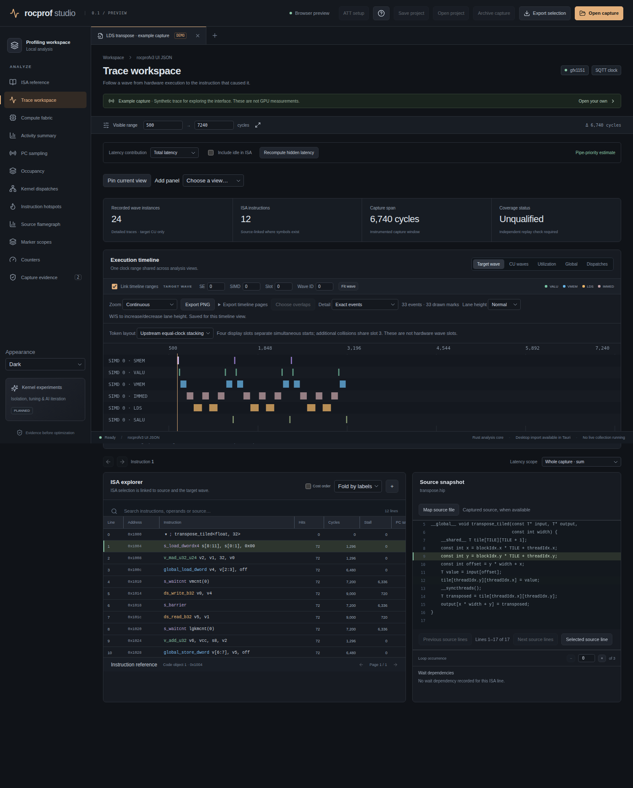

<p align="center">
  
</p>

<p align="center"><em>A GUI profiler for ROCm/RADV with a modern look and feel + agentic integration via MCP</em></p>

rocprof studio opens the artifacts a GPU profiler already produced — decoded rocprofv3 output, kernel-trace and counter CSVs, SPM and PC-sampling JSON, ROCPD/legacy databases, raw ATT and RADV `.rgp` captures — and reconstructs the timeline, per-wave execution, ISA, source linkage, occupancy and counters, with evidence exports for what you saw. One Rust analysis core backs the Tauri 2 desktop app, a headless importer CLI and an MCP server; kernel- and shader-tuning sessions can capture, replay and compare variants of a single dispatch when you ask for them.

**Documentation:** the full site is at <https://pwilkin.github.io/ROCprofGUI/> (built from [`website/`](website/)), covering installation, input formats, every view, the MCP tool reference and the tuning workflows. The sections below are the in-repo reference.

---

# rocprof studio

A local Rust + Tauri 2 workspace for inspecting ROCm profiling captures, with a React/TypeScript analysis interface. This is the first implemented foundation of a broader kernel engineering tool; full rocprof-compute-viewer parity is not complete.



## Run

Requires Node.js 22+, Rust 1.93+, and the [Tauri Linux prerequisites](https://v2.tauri.app/start/prerequisites/#linux): GTK 3, WebKitGTK 4.1 and a C/C++ build toolchain. Other operating systems have not been tested.

```bash
npm ci
# Prepare third_party/decoder-python/decoder-python.zip as described below.
npm run tauri dev
```

Open a decoded `ui_output_*` directory with **Open capture**. Use the **+** beside capture tabs to open a rocprofv3 kernel trace or counter-collection CSV, `filenames.json`, an SPM results JSON, host-trap/stochastic PC sampling JSON, or a RADV Vulkan `.rgp` capture (experimental). The import path itself is read-only. Two other surfaces are not: the MCP server's `profile_run` tool launches an argv under rocprofv3 or under RADV Vulkan tracing, and the kernel- and shader-tuning workers compile candidates and can write replacement source back to disk. They are described under [MCP server](#mcp-server), [Kernel tuning](#kernel-tuning) and [Shader tuning](#shader-tuning-vulkan-experimental); none runs unless invoked.

The browser preview uses an explicitly synthetic example capture:

```bash
npm run dev
```

Directory/raw capture import runs in the desktop Rust process. The browser preview does not have filesystem access or a profiling server.

Build the desktop executable with embedded frontend assets and its adjacent decoder Python resource:

```bash
npm run tauri build -- --debug --no-bundle
# Keep target/debug/decoder-python.zip beside target/debug/rocprof-studio
```

For a direct Cargo release build, run `npm run build` followed by `cargo build --release -p rocprof-studio --features custom-protocol`. The `custom-protocol` feature embeds the frontend; omitting it makes the window try the development URL at `localhost:1420`.

To build a local Debian installer while keeping generated package files under `.codex`:

```bash
python3 scripts/bundle-linux.py --debug
# .codex/linux-package/receipt.json records the package path and SHA-256.
```

This rebuilds the app, stages a copy for Tauri's bundle patching, and packages the executable, decoder Python ZIP, desktop launcher and icons. Debian packaging requires `dpkg-shlibdeps` from `dpkg-dev`. The script combines Python 3.10+ with versioned shared-library requirements detected from the actual executable; the current build requires glibc 2.39 or newer. GTK 3 and WebKitGTK 4.1 remain runtime requirements. The native decoder V2 library and ROCm disassembly tools must be supplied separately for raw ATT; decoded captures do not need them. The local debug and release packages have passed content inspection and startup from extracted, relocated directories on this build host; the release package also resolves its shared libraries here. The release package also passes isolated `dpkg` installation, same-version replacement, removal/purge, clean reinstall and installed-executable startup using this host’s dependency records and libraries. A simulated older-libc record is rejected during configuration. This does not establish a clean-distribution installation or cross-distribution support; the host package database is unchanged. Omitting `--debug` requests the release build.

## Implemented

- Offline ISA reference for CDNA 1/2/3/4 and RDNA 1/2/3/3.5/4: searchable AMD instruction definitions, encodings, operand formats and WMMA/MFMA type compatibility. Open **ISA reference**, or use **Instruction reference** on a selected trace instruction.
- Nested instrumentation marker timeline and flamegraph with source navigation.

- Decoded rocprofv3 JSON, including wave indexes, lazy wave tokens, ISA/source snapshots, occupancy, ATT counters, wave states and dispatch resource metadata.
- rocprofv3 kernel-trace CSV, per-dispatch counter-collection CSV and standalone SPM JSON import.
- Read-only ROCPD kernel dispatch, event-associated PMC and timestamped SPM import, including UUID-partitioned ROCm SDK databases.
- Raw ATT import through an isolated decoder V2 process, including code-object disassembly, cancellation and automatic temporary-output cleanup.
- Target-wave, CU-wave, SIMD activity, global residency, and dispatch timelines with shared range, zoom, pan and cycle measurement.
- Linked ISA/source/token navigation, selected-wave loop occurrences, complete selection history, ISA wait arrows, section folding, resizable columns, search, latency sum/mean, and bounded visible-wave aggregation.
- Rust hidden-latency analysis, with total/nonhidden selection, optional idle contribution, and independent upstream C++ oracle validation.
- Per-SE and per-kernel occupancy plots; instruction-cost histograms and source-to-ISA latency flamegraphs.
- Counter plots, safe scalar expressions, and named-axis tensor definitions: reductions, broadcasting, slices, deltas, comparisons, temporary variables and saved formulas. Missing samples remain gaps; separate banks and agents remain separate domains.
- CU/SIMD residency diagram, static register/LDS metadata and explicit unknown states for missing measurements.
- Capture tabs, selection JSON export, coverage diagnostics and separate summed-duration versus interval-union accounting.

The [parity checklist](docs/upstream-parity.md) records implemented, partial and missing upstream behavior. Complete ROCPD artifact loading, hardware qualification of summary formulas and marker streams, complete counter schema coverage and calibrated SPM alignment are still open. LLM source iteration is not implemented, and this repository commits to no design for it. Kernel replay/input capture and parameter tuning ship today as the surfaces described under [Kernel tuning](#kernel-tuning). The external inputs those open areas are waiting on, and the evidence behind each, are in [blocked inputs](docs/blocked-inputs.md).

## Verify

```bash
cargo test -p profile-core
python3 scripts/check-hidden-oracle.py
python3 scripts/check-marker-oracle.py
node scripts/check-tensor-oracle.mjs
node scripts/check-summary-oracle.mjs
node scripts/check-slot-oracle.mjs
node scripts/check-mip-oracle.mjs
npm test
npm run build
cargo check -p rocprof-studio
npx playwright install chromium
npm run test:ui
```

`python3 -m unittest tests/test_tuning_worker.py tests/test_shader_worker.py` covers the two tuning workers' source handling, SPIR-V matching and save guards without a GPU.

All six `scripts/check-*-oracle.*` scripts compile the vendored upstream C++ in `third_party/rcv/` and compare its output against this application's own implementation, so they need a C++ toolchain. They compare algorithm behavior, not Qt widget rendering; there is deliberately no pixel diff.

### Tests that do not run by default

`cargo test -p profile-core` skips seventeen `#[ignore]` tests, and a green run does not cover them. Fifteen need a retained fixture or the trace decoder, named by an environment variable:

```bash
ROCPROF_WAVE_ARCHIVE=<archive> cargo test -p profile-core --offline -- --ignored
```

| Test | Required environment |
|---|---|
| `wave_stats::archived_stats_match_full_token_oracle` | `ROCPROF_WAVE_ARCHIVE` |
| `wave_viewport::archived_wave_query_budget_counts_visible_tokens_and_preserves_every_identity` | `ROCPROF_WAVE_ARCHIVE` |
| `wave_overview::archived_full_range_overview_represents_all_tokens_with_bounded_groups` | `ROCPROF_WAVE_ARCHIVE` |
| `wave_overview::archived_utilization_overview_preserves_projected_event_counts` | `ROCPROF_WAVE_ARCHIVE` |
| `utilization_export::archived_utilization_projection_for_export_validation` | `ROCPROF_WAVE_ARCHIVE` + `ROCPROF_UTILIZATION_ORACLE` |
| `catalog_transfer::real_archive_catalog_pages_match_every_original_record` | `ROCPROF_CATALOG_TRANSFER_ARCHIVE` |
| `capture_archive::large_csv_observation_archive_roundtrip` | `ROCPROF_CSV_ARCHIVE_INPUT` + `ROCPROF_CSV_ARCHIVE_OUTPUT` |
| `decoder::real_att_decode_and_lazy_wave_read` | `ROCPROF_GUI_TEST_ATT` (+ `ROCPROF_GUI_DECODER_PACKAGE`, `ROCPROF_GUI_DECODER_LIB`) |
| `token_index_archives::archived_native_window_oracles` | `ROCPROF_INDEX_CAPTURES` + `ROCPROF_INDEX_NATIVE_REPORT` |
| `token_index_archives::mixed_archived_indexes_match_streaming_through_eviction_and_reuse` | `ROCPROF_INDEX_CAPTURES` (a JSON array of at least three paths) |
| `rgp::default_mask_capture_decodes_to_consistent_waves`, `rgp::occupancy_capture_accounts_for_every_wave_in_the_dispatch`, `rgp::rocprof_compatible_capture_attributes_every_instruction_exactly`, `rgp::llama_capture_occupancy_matches_marker_grids`, `rgp::driver_internal_dispatches_are_named_after_their_command` | `ROCPROF_GUI_DECODER_PACKAGE` (+ `ROCPROF_GUI_DECODER_LIB` if the V2 library is not on the default path); fixtures are vendored |

Run with `--ignored` but without the environment variable and these fifteen fail rather than skip. The remaining two take no environment variable and are opt-in boundary qualifications that allocate at the two-million limit: `wave_stream::tests::streaming_limit_counts_discarded_rows_and_rejects_extra_before_parsing` and `import::wave_read_cancellation_tests::streamed_token_limit_accepts_boundary_and_rejects_extra_before_parsing`.

Three Playwright specs in `tests/workspace.spec.ts` also skip silently unless their bundle is supplied: `ROCPROF_SPM_BUNDLE`, `ROCPROF_SPM_PARTITIONS_BUNDLE` and `ROCPROF_LARGE_CATALOG_BUNDLE`.

`scripts/check-pcs-fixture.py` compares imported PC sample fields against an externally decoded upstream fixture and takes that fixture's path as its argument; it is not part of a from-scratch repository check. The wait differentials in `tests/oracles/` (`compare-waits.py`, `compare-archived-waits.py`, `compare-packed-waits.py`) assert a **pinned** expected-difference count via a required `--expected-differences`, not zero divergence from upstream; revisit the pin when upstream behavior changes.

`@playwright/test` is pinned to an exact version rather than a `^` range, because each Playwright release requires a specific Chromium build: a floating range can resolve to a version whose browser is not in the local cache, and the whole browser suite then fails in `browserType.launch` with an error that never mentions a version mismatch. Run `npx playwright install chromium` after changing that dependency. For an existing Chromium installation, set `PLAYWRIGHT_CHROMIUM_EXECUTABLE` to its executable path instead. The tests start a fresh local server on port 1421, separate from the interactive preview on port 1420. Browser artifacts default to `.codex/test-results`; pass `--output .codex/<run>/results` to keep a separate run. Screenshots and exported test files use each test’s output directory, so reruns do not overwrite documentation images or prior milestone artifacts.

Inspect imports without a GUI:

```bash
cargo run -p profile-core -- /path/to/ui_output_capture
cargo run -p profile-core -- /path/to/kernel_trace.csv
cargo run -p profile-core -- /path/to/spm_results.json
cargo run -p profile-core -- /path/to/ui_output_capture se0_simd0_slot0_wave0.json
```

The headless CLI and the desktop use different import dispatchers and do not accept the same inputs. The CLI goes through `import::load_capture_options`, which has no `.rocprof-att` manifest arm, computes no input fingerprint and passes no cancellation flag. The desktop goes through `project::load_input_options`, which handles `.rocprof-att`, fingerprints the input before and after import, and is cancellable. A `.rocprof-att` manifest that the desktop opens is therefore rejected by `cargo run -p profile-core`.

Regenerate the synthetic example through the same Rust importer used by the desktop:

```bash
python3 scripts/make-fixture.py
cargo run -q -p profile-core -- fixtures/transpose-ui --bundle > public/demo.json
cargo run -q -p profile-core -- fixtures/transpose-ui --hidden > public/demo-hidden.json
```

See [architecture](docs/architecture.md) for how the layers divide and where the query budgets live, [open work](docs/open-work.md) for the itemised outstanding work and what has been closed, [validation](docs/validation.md) for the checks actually performed, [blocked inputs](docs/blocked-inputs.md) for what the remaining work is waiting on, [profiling caveats](docs/profiling-caveats.md) for lessons recovered from the existing ROCm sessions, and [RADV profiling](docs/radv-profiling.md) for the experimental Vulkan path.

## Current limits

Imports are capped at 256 MiB per file and two million records in the main record arrays. The 256 MiB per-file cap covers sidecar, JSON and CSV inputs; a ROCPD/`.rpd` database is bounded only by the two-million-record per-query limit, so a larger database can still be opened. Embedded source snapshots are capped at 2 MiB per file / 16 MiB per capture; larger native source mappings use absolute file references up to 512 MiB per file (see Workspace projects). Up to six native captures can remain open. Visible-wave queries reject windows exceeding 128 wave files or 500,000 tokens rather than silently sampling them. Hidden-latency analysis rejects captures above four million detailed tokens. The UI pages timeline lanes and ISA rows; it is not yet an indexed out-of-core viewer. See the architecture for the scalability plan.

Synthetic example values are not GPU measurements. Coverage cannot be proven from a dispatch CSV alone. No metric or diagram should be read as evidence that unobserved CUs, spills, bank conflicts or graph replays are zero.

## Raw ATT setup

Raw decoding uses the ROCm `rocprof-trace-decoder` Python package (and its `pyelftools` dependency) plus `librocprof-trace-decoder.so` V2. The native parser runs in an isolated child process; the Rust app owns its temporary decoded files until the capture is closed. It never writes decoded files into the input directory. Imports have a five-minute timeout and a Cancel import button.

The desktop build ships a pure-Python ZIP resource containing the qualified `rocprof-trace-decoder` 0.2.2 API and `pyelftools` 0.33. Tauri resolves that resource and the worker puts it first on its import path; no `PYTHONPATH` or package installation in the selected interpreter is required. Python, the native decoder V2 library and ROCm's disassembly tools remain external requirements.

Prepare the build resource from a decoder source checkout and a local pyelftools installation:

```bash
mkdir -p third_party/decoder-python/build
TMPDIR="$PWD/third_party/decoder-python/build" python3 -m pip install --target third_party/decoder-python/build/dependencies pyelftools==0.33
python3 scripts/package-decoder-python.py \
  --decoder-source /path/to/rocprof-trace-decoder \
  --dependencies third_party/decoder-python/build/dependencies
```

The archive is vendored at `third_party/decoder-python/`, with its versions and SHA-256 recorded in [PROVENANCE.md](third_party/decoder-python/PROVENANCE.md); the `build/` scratch directory beside it is not tracked. The packager checks dependency versions, retains both licenses and records every packaged file's SHA-256 in `decoder-package.json` inside the ZIP. Repeating it with identical inputs produces identical archive bytes. Prepare this resource before `tauri dev` or `tauri build`; its path is declared in the Tauri bundle configuration. Keep the copied ZIP alongside an unbundled debug executable. Installed bundles use Tauri's resource directory.

Optional environment overrides:

```bash
export ROCPROF_GUI_PYTHON=python3
export ROCPROF_GUI_DECODER_LIB=/path/to/librocprof-trace-decoder.so
# For the headless importer, or to explicitly replace the desktop resource:
export ROCPROF_GUI_DECODER_PACKAGE="$PWD/third_party/decoder-python/decoder-python.zip"
```

Without a library override, the decoder uses its ROCm library discovery. The headless core remains compatible with an installed Python decoder package when no ZIP is configured. A configured missing or malformed ZIP fails explicitly. Diagnostic exports record the selected interpreter, library and Python-package path; native availability is established by actual decoding, not by those configuration fields.

Open a raw capture directory, or choose an `.att` file using the capture-tab **+**. Selecting a file imports the matching process/run across available SE files. Named inputs use rocprofv3 names (`*_shader_engine_SE_RUN.att` and `*_code_object_id_ID.out`); a directory with multiple runs opens a run chooser. For arbitrary filenames, use **ATT setup** to choose the traces and code objects and enter their recorded shader-engine/code-object IDs. Opening an unrecognized `.att` filename also opens setup. Save the resulting `.rocprof-att` manifest to decode; reopen that manifest directly or through a saved workspace project. Code-object IDs are stored as decimal strings to preserve all 64 bits. Setup does not guess IDs, rename inputs or load unrelated sibling code objects. Manifests can also use paths relative to their own directory. ROCPD is explicitly in scope even though the upstream reader is stubbed.

To run the optional real trace integration test:

```bash
ROCPROF_GUI_TEST_ATT=/path/to/raw/trace cargo test -p profile-core --test decoder real_att_decode_and_lazy_wave_read -- --ignored --nocapture
```

## MCP server

The desktop app starts a Model Context Protocol server by default on every launch. This is a deliberate choice, not an oversight: the server is the supported way to drive the analysis core from an agent or script, and it is on unless you pass `--no-mcp`.

It binds loopback `127.0.0.1:8765` only and never a routable interface. Requests without a matching `Authorization: Bearer <token>` header are rejected with 401. The token is 32 bytes read from `/dev/urandom`, written once with `create_new` and mode `0600`, and reused on later launches; a token shorter than 32 characters or outside `[A-Za-z0-9_-]` is refused. It exposes 31 tools over the same analysis core as the GUI, with caps of 32 connections and 16 sessions. One tool runs at a time; a concurrent call is rejected with `-32001` rather than queued. There is no event replay or resumption, and cancelling a tool does not roll back writes it already made.

Tool calls are serialized: while one runs, others are refused with "Another MCP action is running". There are two exceptions:

- **Status reads:** `tuning_status` and `profile_status` only read state, so they answer at once. A client can watch a long capture or run while it is still in progress.
- **Retries:** a call identical to the running one (same tool, same arguments) joins it and receives its response. This is what a client does after its connection drops mid-call and it reconnects. A response the server could not deliver is kept for 30 minutes, and an identical retry receives it instead of running the call again. A call whose response was delivered runs anew when repeated.

Everything the application writes for itself lives under `~/.rocprofgui`: the bearer token at `mcp/token`, MCP job output under `mcp/jobs/`, and tuning sessions under `kernel-tuning/sessions/` and `shader-tuning/sessions/`. An analysis job deletes its folder when it succeeds and keeps only its logs when it fails; `profile_run` and `profile_start` output stays until you delete it, since it is the capture itself. Set `ROCPROFGUI_HOME` to relocate that directory, or `--mcp-token-file` to move just the token. Nothing is written into the working directory, so the location does not depend on where you launch from. If you relocate the token, keep the new path out of version control and off shared storage — the token is the only thing standing between a local process and the tools below.

A tuning session's captured inputs can be large. By default a HIP capture keeps only the allocations the kernel's arguments reach: the scan follows pointers inside allocations of up to 64 MiB, which covers pointer tables, and keeps larger allocations whole. An application that allocates tensors separately then captures a GEMM in megabytes: 110 MB of Gufo's 78.5 GiB of allocations. One that puts all its weights in a single allocation, like llama.cpp, still captures that allocation (4.5 GB for a 9B IQ4_NL model). Each run's output validation briefly dumps as much again. `config.captureScope: "all"` snapshots every allocation in the process instead, for kernels that reach memory some other way. Disk use is bounded:

- **Capture** refuses to start with less than 8 GiB free. A failed attempt deletes its partial snapshot, so retries do not pile up.
- **Validation** is skipped, with the reason shown, when there isn't room to dump every region. Its dumps are deleted whether or not it succeeds.
- **Closing** a session deletes its captured inputs and validation dumps, keeping results, logs and source backups. Sessions cannot be reopened, so nothing still usable is lost.
- **At startup** the app does the same for sessions left by rocprof-studio processes that have exited, never touching another running instance's. Each pruned session records what it freed in `pruned.json`.
- **Model downloads** stay in the application's normal cache: a capture no longer redirects `LLAMA_CACHE` into `~/.rocprofgui` unless `config.modelCache` asks for it.

```bash
rocprof-studio --no-mcp                      # do not start the server
rocprof-studio --mcp-port PORT               # bind a different loopback port
rocprof-studio --mcp-token-file PATH         # write the bearer token elsewhere
rocprof-studio --headless                    # serve MCP without a window
```

Headless mode does not initialize the graphical toolkit and runs with `DISPLAY` and `WAYLAND_DISPLAY` unset. From a graphical session, launch `rocprof-studio` with the same MCP port and `ROCPROFGUI_HOME`/token-file settings: the launcher authenticates to the running service, exits, and the existing process opens the GUI with its current captures and tuning sessions. Closing that window hides it while the service continues; launching the GUI again shows the same window. Without a running service, a normal GUI launch starts one. A headless process needs the desktop libraries installed to load the binary, even though it needs no display server until a GUI attaches.

Profiling and tuning tools can launch programs and write files. `profile_run` executes an argv you supply under rocprofv3 and returns output files to import; its selections combine in one run: `counters` become `--pmc` hardware counters, `traces` names rocprofv3 trace streams (`kernel`, `hip`, `marker`, `memoryCopy`, `memoryAllocation`, `scratchMemory`, `hsa`, `rccl`, `runtime`, `sys`), and `att` requests an SQTT thread trace with optional `targetCu`, `simdSelect`, `bufferSize` and `shaderEngineMask`. With none of the three it collects a kernel trace, and importing the raw `.att` output needs the "Raw ATT setup" prerequisites above (`rocprof-trace-decoder` 0.2.2, `pyelftools` and the native `librocprof-trace-decoder.so` V2). With `tracer: "radv"` it runs under RADV Vulkan per-submit tracing (experimental) instead. For long-lived applications, `profile_start` gates the capture. The default `tracer: "radv"` launches a file-trigger RADV run and returns immediately; headless compute requires a RADV build with [the compute-trigger patch](docs/radv-compute-trigger.patch), since stock Mesa checks file triggers only during swapchain presentation. `tracer: "rocprofv3"` launches a HIP/ROCm application armed with `ROCP_TOOL_ATTACH=1`, and each `profile_trigger` then attaches rocprofv3 for one bounded time window (`windowMs`, default 5000 ms) collecting the same `counters`/`traces`/`att` selection into a `window-N/` directory. A window is time-based and cannot isolate a single dispatch, detachment can lag the window end, and rocprofv3 requires every window of one process to request the same streams — a mismatched window produces no files, which `profile_stop` reports as a warning. `profile_trigger` arms a capture, `profile_status` checks progress (`windowRunning` in the rocprofv3 mode), and `profile_stop` collects files — the `.rgp` captures or every window's output — and reports overwritten filenames and empty windows. `profile_run` takes optional `env` variables (the runner's own `LD_PRELOAD`, `HSA_TOOLS_*` and `TMPDIR` handling cannot be overridden) and `timeoutSeconds` (default 600, at most 3600); it uses no shell and can be cancelled. RADV writes its captures to a fixed `/tmp` path, so a RADV run moves the files it wrote into the job folder, after checking there is room. The tuning tools compile and run candidate kernels, and the tuning worker can write a kernel source file back to disk. Any local process that can read the token file can drive both, so on a shared or multi-user host either run with `--no-mcp` or keep the token file readable only by the account running the app.

`capture_analyze` shells out to Node.js at runtime, because it reuses the frontend's own analysis modules through an esbuild bundle. Set `ROCPROF_MCP_NODE` to select a specific interpreter. Node.js is also required at **build** time: `src-tauri/build.rs` runs `scripts/build-mcp-analysis.mjs` and fails the build if it is missing. That build script declares `cargo:rerun-if-changed=../src`, so editing the TypeScript frontend rebuilds the Rust crate.

## Kernel tuning

"Tune this kernel" on a selected dispatch opens a tuning session that captures a kernel's inputs, replays it, compiles candidate variants and can write a replacement source definition back to disk. It requires a GPU, `hipcc`, and a Kerncap runtime built by `scripts/setup-kernel-tuning.py`. The script clones `AMDResearch/intellikit` pinned at `c5b2098` and applies two patches: `scripts/kerncap-replay.patch` for replay timing, and `scripts/kerncap-capture-scope.patch`, which adds the reachable capture scope. Rerunning it on an existing checkout applies whichever patch is missing. That script installs into `~/.rocprofgui/kernel-tuning/runtime`, which is where the app looks for it; both honour `ROCPROFGUI_HOME`.

Known rough edges, none of them hardware-dependent:

- A session opened from an MCP `profile_run` trace reruns that run's command, environment and working directory, with the repository holding the application as the source tree. A trace opened any other way starts with an empty command to fill in.
- Captured input snapshots can reach several GiB per session; the data-directory notes above describe how that is bounded and cleaned up.
- A session cannot be reopened once its window or MCP session is closed, which is why closing deletes its captured inputs.

Timing deltas reported by a session are not a claimed speedup: no counterbalanced A/B or clock-stability experiment is run. The qualification host was gfx1151, and the sampled kernel contains no WMMA or LDS instructions, so WMMA-heavy kernels and LDS bank-conflict behavior are unqualified.

What this surface does not do: there is no replay-equivalence gate proving a replayed kernel behaves like the original, no experiment structure over an immutable baseline, and no staged qualification of a candidate before its timings are reported. Read a session's output as a measurement of what it actually ran, not as a validated speedup.

## Shader tuning (Vulkan, experimental)

"Tune shader" on a dispatch in a RADV capture opens the Vulkan counterpart of kernel tuning: capture one dispatch, replay it in isolation, and compare edited variants against it. It needs a GPU, and a runtime that `scripts/setup-shader-tuning.py` builds into `~/.rocprofgui/shader-tuning/runtime`: the `VK_LAYER_ROCPROF_capture` capture layer and the `vkreplay` harness, both from `tools/vkcap/`. The MCP tuning tools drive the same sessions.

The [gfx1201 validation report](docs/gfx1201-validation.md) records RADV and ROCm capture, replay, correctness, and application benchmark results on the Radeon AI PRO R9700.

A session runs in four steps:

1. **Capture.** The application runs again under the capture layer, which stops at the dispatch with the traced pipeline name and workgroup count. It records the SPIR-V, the specialization and push constants, the device's enabled extensions and features, and every bound buffer range, copied immediately **before and after** the dispatch. When the capture came from an MCP `profile_run`, the session reruns the same command and environment. llama.cpp names its pipelines only with `GGML_VK_DEBUG_MARKERS=1`, which sessions set by default.
2. **Find source.** For ggml's Vulkan backend, the captured SPIR-V is matched against the build's generated shaders. The comparison ignores the capabilities, extensions and execution modes an application may add at run time; ggml adds fp16 float controls. The generator then reruns for that one source through a logging `glslc`, which recovers the exact compile command, confirmed by rebuilding to identical bytes. Every file that compile reads becomes editable.
3. **Run.** The captured shader, or an edited variant compiled with the recovered command, is replayed in isolation:
   - The application's run-time SPIR-V edits are reapplied to each variant.
   - By default every timed iteration restores all inputs from pristine copies, and GPU timestamps bracket the dispatch: the isolated best case. **Replay conditions** change that. *Sustained* dispatches back to back after one restore, as an application keeps the GPU busy. *Buffers in* chooses device-local memory, ggml's unified-memory type, system memory (GTT), or *auto*, which is system memory on integrated GPUs. *Replays* repeats the run with fresh allocations and reports their spread. A cache flush can precede each dispatch. *Application-like* selects sustained, auto and three replays.
   - Validation compares every bound buffer byte for byte with what **the application's own dispatch** produced, not with another replay. A sustained run also checks that two back-to-back dispatches still produce the same outputs, i.e. that the dispatch does not read what it writes.
   - The driver's compiler statistics (VGPRs, SGPRs, LDS, spills, wave limit) and ISA are reported. Where `VK_KHR_performance_query` is available, performance counters (on by default) also report GPU cycles, the clock the dispatch ran at, and the L0, L1 and L2 hit rates. Mesa 26.2.0 does not advertise this extension on GFX12, so those counter fields remain unavailable on gfx1201.
   - Deltas compare a run with the latest earlier run made under the same conditions.
   - The run records the driver version and GPU it replayed on.
   - A run can also be traced with RADV, and the trace opened here.
4. **Save** writes the edited files back, refusing if a file changed on disk since it was read, and keeps a backup.

Qualified on gfx1151 with llama.cpp's IQ4_NL matrix multiply. The captured shader replays bit-exactly; a comment-only edit compiles back to the captured SPIR-V byte for byte; and a one-constant edit, shared-memory row padding 4 → 2, measured 36% and 28% faster on two captured shapes with bit-identical outputs. In the whole application the same change gave about 8% on `llama-bench` pp512: the largest matrix multiplies gained 4–7% there against 30% in replay (details in open-work's eighth pass). Pad 2 also breaks the 16-byte stride alignment Vulkan requires of cooperative-matrix loads; RADV happens to tolerate it.

Limits:

- **Descriptors:** only buffer descriptors (storage and uniform) can be captured. A dispatch that binds images, or reaches memory through buffer device addresses, is refused or will not replay faithfully.
- **Source recovery:** automatic only for ggml's Vulkan shader build. Other projects can replay and time the captured SPIR-V, but not edit it.
- **Pipeline names:** the dispatch must have one, from the application's debug names or labels. A kernel identified only by pipeline hash cannot be selected.
- **Capture size:** a capture holds every bound range, and ggml binds the rest of its compute buffer as the output range, so one matrix-multiply capture is about 250–530 MB. Sessions live under `~/.rocprofgui/shader-tuning/sessions`. A failed capture attempt is deleted, and closing a session deletes its capture (see the data-directory notes above).
- **Timing claims:** timing deltas are measurements of the isolated dispatch, not a claimed application speedup: no counterbalanced A/B run or clock-stability control is made, and a real application also pays for the kernels around it. A default replay is a best case. Inputs are restored between dispatches, so the GPU never runs under sustained load. On an APU the replay's buffers usually land in the VRAM carve-out, where the application's data may not. On llama.cpp both mattered, but only for higher-occupancy variants: a 30% isolated gain was 4% inside the application (open-work's ninth pass). Application-like conditions predicted that (+1.7% against −24% in the best case), and the drop in L2 hit rate showed why. Confirm a variant in the application before relying on it.
- **Driver:** the replay compiles with whatever driver the session's environment selects. A session created from an MCP `profile_run` inherits that run's `VK_DRIVER_FILES`, so a session profiled on a patched Mesa tunes for that Mesa's compiler. Mesa 26.0.8 and 26.2.0 compile the same IQ4_NL shader to 192 and 120 VGPRs at pad 2.

The replay conditions and counters are `vkreplay` options, which can also be run by hand on a session's capture directory:

- `--mode sustained` restores the inputs once, then dispatches back to back. This is only valid for a dispatch that does not read what it writes.
- `--memory gtt` puts the bound buffers in host-visible system memory, `--memory app` in the memory type ggml uses on unified-memory GPUs, and `--memory auto` in system memory on integrated GPUs and device-local memory otherwise.
- `--flush-mb N` evicts the caches before each dispatch.
- `--counters` adds the driver's performance counters, including GPU cycles and cache hit ratios. Cycles over time give the clock the dispatch actually ran at.

## RADV Vulkan captures (experimental)

A `.rgp` capture written by Mesa's RADV driver can be opened directly, giving hardware counters, thread traces and kernel names from Vulkan compute. On gfx1151, which ROCm's AQLprofile filter excludes from SPM, this is the only route to hardware counters. The path is experimental: it is qualified on gfx1151 only, and full per-instruction data needs a patched RADV. [docs/radv-profiling.md](docs/radv-profiling.md) gives the required steps: building the patched driver, capturing, and opening.

```bash
# Occupancy for every wave at any scale, plus counters (stock RADV)
MESA_VK_TRACE=rgp MESA_VK_TRACE_PER_SUBMIT=1 RADV_THREAD_TRACE_INSTRUCTION_TIMING=false ./your-vulkan-app
# Full per-instruction data as well (RADV built with docs/radv-rocprof-compat.patch)
MESA_VK_TRACE=rgp MESA_VK_TRACE_PER_SUBMIT=1 RADV_THREAD_TRACE_ROCPROF_COMPAT=true ./your-vulkan-app
# writes /tmp/<app>_<timestamp>_submit<N>.rgp
```

`MESA_VK_TRACE_PER_SUBMIT` matters for compute: the frame-based trigger never fires without a swapchain. Mesa 26.2 numbers each submit's file; Mesa 26.0 named them by the second only, so a program issuing many submits per second overwrote its own captures.

### Capture modes

Thread traces are decoded with ROCm's `rocprof-trace-decoder`, the same decoder raw ATT uses, so it must be installed. What a trace holds depends on RADV's token mask:

| Capture | Result |
|---|---|
| `RADV_THREAD_TRACE_ROCPROF_COMPAT=true` (patched RADV) | **Full.** Occupancy for every wave of every dispatch, and exact per-instruction hits, latencies and stalls for the traced CU, at any scale. |
| `RADV_THREAD_TRACE_INSTRUCTION_TIMING=false` | **Occupancy.** Exact wave lifetimes for every wave on every CU at any scale, with no per-instruction data. |
| RADV's default, small dispatch | Wave lifetimes, states and timing, but per-instruction data is effectively absent (see below). |
| RADV's default, anything busier | Thread trace rejected with the reason; counters still import. |

RADV's default token mask includes ALU- and VMEM-execution tokens that `rocprof-trace-decoder` has no encoding for, because AMD's own profiler never enables them. Left in, they desynchronise the decoder. The importer overwrites them with NOP nibbles, which leaves stream length, alignment and timing unchanged. But RADV reports instruction execution through exactly those tokens, so on a 64-iteration loop kernel only 8 of the 1,052 instructions the traced waves executed are attributed. Busier default-mask streams also contain token types that are not publicly documented, and are rejected.

[`docs/radv-rocprof-compat.patch`](docs/radv-rocprof-compat.patch) adds an opt-in `RADV_THREAD_TRACE_ROCPROF_COMPAT` option to Mesa 26.2.0. On GFX11 and GFX11.5 it programs the token mask AMD's aqlprofile uses, so the stream holds only tokens the decoder knows. Default behaviour is unchanged, and GFX10 and GFX12 are untouched. On gfx1151 every instruction is then attributed exactly: each row of a 64-iteration loop body is hit 64 times per wave, and a 4,096-workgroup × 4,096-iteration dispatch decodes with all 4,096 waves in occupancy and 4,096 hits per loop row on every traced wave. [docs/radv-profiling.md](docs/radv-profiling.md) gives the build and capture steps.

The importer infers the mode from the stream, since the RGP file does not record the mask: a stream with execution tokens used RADV's default mask, one without them and with attributed instructions is full, and anything else is occupancy only.

On gfx1201 with stock Mesa 26.2.0, occupancy-mode RGP traces decode with named dispatches, four shader engines and SPM counters. GFX12 streams bypass the GFX11 token sanitizer. The default instruction-timing trace lost data even for a small ADD dispatch, including with timing limited to one shader engine; counters still import. The GFX11 compatibility patch does not enable GFX12 instruction timing.

Every thread trace must pass four checks before its waves are shown, and failing any one rejects the whole trace rather than showing part of it:

1. No token header remains that neither the decoder nor this importer can size.
2. The decoder reports no lost trace data.
3. The decoded shader clock stays consistent with the realtime clock the trace also carries. Realtime never goes backwards; the shader clock never runs far above its median rate; and across a gap, where realtime tokens pause while the GPU idles, the shader clock cannot nearly stop, because RADV inhibits clock gating while tracing. A misparsed token breaks one of these.
4. Every decoded wave and occupancy timestamp lies inside its shader engine's own trace window. This catches a desync absorbed into one oversized wave state, which per-wave invariants miss.

Code objects come from the capture's code-object database, and are placed at the load addresses its loader events record, matched by pipeline hash. When a trace is imported, SPM samples are placed on the trace's clock through the same realtime pairs.

### Kernel names and dispatches

RADV leaves the RGP pipeline-name field empty. It does record its own instrumentation markers inside the thread trace: one event per hardware dispatch, pipeline binds and the application's debug labels. The importer reads them, so each kernel is named:

- after the innermost debug label open at its dispatches, minus a trailing workgroup count such as ggml's `name (x,y,z)`. For llama.cpp, run with `GGML_VK_DEBUG_MARKERS=1`;
- for RADV's own copy and fill shaders, after the command they implement, such as `vkCmdCopyBuffer (RADV internal)`;
- otherwise by the pipeline's API hash, `pipeline 834527b9cb9b4ffb`, which RGP also shows and which is stable across runs.

The decoder recovers each dispatch from its register writes. Each is then matched to its marker, and a `vkCmdDispatch` gets its grid from the marker's workgroup counts. Matching needs equal counts, the same queue, and every application dispatch to have run the pipeline its marker says was bound. Otherwise nothing is attached, and a warning says so.

### Counters

The `DERIVED_SPM` section is imported with the capture's own names, units, groups and descriptions. RADV writes only this derived form on GFX10 and later. Samples are 4,096 clocks apart, timestamped with the GPU's 100 MHz timestamp, so a counters-only capture uses a nanosecond axis. `RADV_THREAD_TRACE_CACHE_COUNTERS` (default on) is the SPM master switch despite its name. Counters are not attributed to a dispatch or a wave. The byte and hit-rate counters measure memory-side traffic, which write-back caching and the profiler's own trace writes both affect: they are not the workload's requested traffic.

Mesa 26.2 also takes raw hardware events through `RADV_SPM_COUNTERS_CONFIG=<file>`, with lines of the form `NAME=BLOCK,EVENT,INSTANCE|ALL,sum|max|avg` under `[Group]` headers; `fixtures/radv-rgp/compute-raw-counters.conf` is an example. These import as hardware counters with a warning, because on gfx1151 they need care:

- RADV sums each line over the block instances it expands to, which need not include every CU. TA buffer-wavefront counts for a dispatch of known size read 61–63% of the true total. Treat them as activity within those instances, not GPU totals.
- SQ events read zero in every sample, and the importer flags any raw counter that does. SQ event IDs above 35 are rejected, which excludes the instruction-count events, and GRBM has no free SPM slots.
- Any line RADV rejects makes device creation fail, so the application does not start.

## Diagnostic reports

Open **Capture evidence → Export diagnostic manifest** to save a versioned JSON report. It records application/decoder configuration, capture metadata and warnings, collection counts, field availability, current workspace settings, definition drafts and SHA-256 hashes of source replacements. Desktop exports use a native save dialog; browser exports download the report. Raw trace data and source text are not embedded. Local paths and definition text are included. The report explicitly distinguishes imported field presence from verified collection/replay coverage. Native captures now include their import-time SHA-256 file-set fingerprints in diagnostic context; export does not rehash inputs or claim performance qualification.

## Source flamegraph viewport

Source latency and PC-sample flamegraphs support independent cumulative-weight bounds, zoom in/out, half-viewport panning and **Full flamegraph range**. The axis is accumulated cycles or samples, not execution time. Entries crossing the viewport edges are clipped; their labels retain the full recorded weight. Viewports are saved per capture, metric and source focus in projects. Selecting a source group enters its own viewport; **Reset zoom** returns to all source groups. SVG export uses the visible interval.

## Marker flamegraph viewport

Marker scopes has a separate cumulative-duration viewport with committed bounds, zoom/pan controls and **Full marker flamegraph range**. Settings persist per capture and hardware scope, including project save/reopen. Nested rectangles are clipped to this viewport while labels retain their full aggregated durations. The workspace time interval still filters the underlying marker durations; the cumulative axis is not an execution timeline. SVG export records both intervals.

## Histogram range

Instruction hotspots has an independent mean-latency axis in cycles per issue. Commit Min/Max edits with Enter or by leaving the field; Escape restores the current value. Empty or reversed intervals preserve the plotted range. **Automatic histogram range** follows the current instruction data again. The axis interval and bin count are retained per capture and saved in workspace projects, independently of trace-time navigation.

## Appearance

Choose **Dark** or **Light** from the sidebar Appearance selector. The choice is remembered locally across launches and applies to the trace canvas, tables, source/ISA views and analysis panels. PNG and SVG exports use the selected background and text palette; instruction and resource data colors retain their meaning. If preference storage is unavailable, the selection still works for the current session and the sidebar reports that it could not be saved.

## ROCPD input

Choose a `.rocpd`, `.db` or `.sqlite` file using the capture-tab **+**. The current Rust adapter supports ROCm SDK dispatch/symbol tables, CPU regions and arguments, event-associated PMC values and timestamped SPM records. Synthetic databases generated from the SDK's official schemas and fixture generator for versions 3.0.0–3.0.4 exercise the importer. It preserves GUID/process identities, unknown resource values and integer timestamp origins, and does not modify the database.

Event-associated counters appear in a separate searchable, paginated table in Counters. The importer preserves definition and event identities within each UUID partition, zero versus missing values, and every matching dispatch. Ambiguous associations remain explicit. These observations are not timestamp samples and do not participate in line plots or workspace time filtering. Dispatch links navigate to the recorded interval. The adapter requires the SDK dispatch/symbol table structure even when its dispatch table is empty.

ROCPD support is still incomplete: additional schema variants and embedded/external raw trace artifacts remain on the baseline checklist. Database dispatch durations and SQTT shader clocks must not be joined without calibration.

## ISA reference data

The offline catalogue is generated from [AMD machine-readable ISA specifications](https://gpuopen.com/machine-readable-isa/) under their MIT license. Nine architecture files are loaded individually; the desktop build embeds them with the application. Matrix compatibility separates WMMA, sparse SWMMAC, MFMA, sparse SMFMAC and scaled MFMA. Entries preserve exact AMD spellings and link to operand formats, encoding fields, source hashes and architecture manuals. Instruction support and matrix layouts are architecture-specific; compiler availability and performance are separate questions.

To regenerate from a downloaded AMD XML ZIP:

```bash
python3 scripts/build-isa-reference.py /path/to/amd-isa-specifications.zip
npm test
npm run build
```

Review the archive hash, XML release versions and resulting support changes before adopting an updated archive. The generator deliberately selects the nine requested architectures; it does not silently add other generations from newer downloads. The current source fingerprint and validation are recorded in [docs/validation.md](docs/validation.md).

## Counter definition files

In **Counters → Dimension-aware definitions**, import upstream `.txt`/`.def` files or create new drafts. Each file has its own name and text; switching views or restarting restores the selected draft. The previous single-editor preference is migrated on first use. Imports add files and preserve existing drafts, including filename collisions. Evaluation applies to the selected file and counter domain.

**Export definitions** opens a native save dialog in Tauri and downloads a plain-text file in the browser preview. Native exports use a temporary file and atomic replacement. Draft storage and export are separate: editing a draft never modifies the file it was imported from. Files are limited to 256 KiB each, with 32 files and 2 MiB of text per library. Binary/NUL text and malformed stored libraries produce errors. Storage failures are shown explicitly so drafts can be exported before leaving the view.

Dimension-aware evaluation runs in a background worker. **Cancel evaluation** stops the job; editing definitions, changing domains, switching captures or leaving the view also invalidates the old job. Evaluation has explicit sample/cell limits and a 30-second timeout, and results are displayed twelve series per page. Limits and native/browser verification are documented in [docs/validation.md](docs/validation.md#cancellable-counter-worker).


The **Activity summary** view adds whole-capture instruction cost shares and MI200/MI300 ATT activity bars, peak ratios and per-CU tables. It preserves missing measurements and utilization above 100%, and explains its clock scaling and peak semantics in the view. Its peak algorithm is checked against unchanged upstream C++ (`node scripts/check-summary-oracle.mjs`). Explicit architecture and named counters are required; generic `vega` decoder output is not enough to choose hardware formulas. See [validation](docs/validation.md) for real-capture and size limits.

Raw host-trap or stochastic rocprofv3 JSON can be opened with the capture-tab **+**. Samples aggregate by process entry, code-object ID and exact code-object offset; repeated instruction text does not merge distinct addresses. Stochastic issued/stalled counts and named SDK stall reasons populate the existing sampling views. Host-trap captures expose attributed sample totals, sorting and source flamegraphs, while issued/stalled counts and reasons remain unavailable. Total-sample metrics, sort order and source focus persist in projects. Unknown code-object samples are counted separately, and sampling-lock contention is reported without dropping the affected records. These are statistical samples, not instruction executions or SQTT timings. The importer accepts the SDK `pc_sample_stochastic` and `pc_sample_host_trap` record/string-table schemas, with a 256 MiB file and two-million-sample bound. Host-trap and stochastic sampling CSV also open in a separate searchable, paginated observation table. Every field, duplicate row and extension column is retained, with exact timestamp/ID strings and issued/not-issued sample totals when reported. CSV lacks resolved PC/code-object identities, so it does not populate ISA counts or infer dispatch ownership from text or unscoped IDs. Observations survive portable archive round trips; search and page use the existing per-capture/project sampling preferences. Native import and project reopen transfer observations in ordered pages of at most 4,096 rows and 4 MiB, retaining only column names and a count in the initial header. The workspace changes only after complete assembly; cancellation and failed pages discard the staged import. An individual row larger than 4 MiB is rejected. CSV parsing in the desktop app checks cancellation during bounded input reads and between records, including dispatch normalization. The full table still resides in memory after import. Observation search yields between 4,096-row batches and cancels superseded queries. Pending searches hide stale results; clearing the query returns to the unfiltered page without constructing a full-row index. Other API and dispatch records in a sampling JSON are not imported into this view.

When a JSON file contains both sampling methods, the desktop presents a method chooser. Each choice opens a separate, method-labelled capture and reports how many observations belong to the other method. Reopen the input to inspect the other distribution in another tab. Projects retain the method choice alongside the input fingerprint; counts from different sampling methods are never implicitly combined.

Before collecting SPM, check `rocprofv3-avail list --spm-config --spm`. Configuration intervals and counter eligibility are separate capabilities: a GPU can advertise an interval range while the installed stack exposes no usable SPM counters.

Combined SPM/PC JSON retains both collections in one capture. The earliest SDK timestamp becomes the shared origin, calculated with integer arithmetic before offsets enter the UI; unrepresentable spans fail explicitly. SPM dimensions, counter definitions and dispatch partitions are preserved. Calibration uses the shared origin when reconstructing absolute SPM timestamps. **Attach SPM** attaches counters only and reports that PC observations remain in the source capture; it does not infer a connection to the destination trace’s ISA.

The **PC sampling** view preserves issued/stalled observations and per-category stall reasons, with aggregate and per-instruction breakdowns, search, sorting and linked ISA navigation. Decoded upstream fixture compatibility is reproducible with `python3 scripts/check-pcs-fixture.py /path/to/rocprof-compute-viewer/tests/pcsampling`.

The source pane supports explicit **Map source file** and **Restore captured source** actions. Replacements are scoped to the recorded path and capture and can be embedded in saved projects, with 2 MiB per-file / 16 MiB per-capture limits. Source rendering uses 200-line pages and follows the selected ISA line.

Captured source snapshots are indexed at import and read on demand for the selected instruction. Larger source sets no longer consume the previous 16 MiB eager-load budget. Native source pages support files up to 512 MiB; read errors can be retried or resolved with an explicit local mapping.

The timeline defaults to upstream-compatible equal-clock token stacking, with a flat-bar option. Selection follows each visible rectangle and highlights only the selected loop occurrence. The slot allocator is checked against upstream C++ with `node scripts/check-slot-oracle.mjs`.

The ISA **Latency scope** selector includes whole-capture sum/mean, target-wave and selected-SE visible-range sum/mean, target-wave maximum, and selected occurrence. Maximum and selected-occurrence costs use the complete target wave independently of the viewport. Occurrence is zero-based and counted separately for each instruction; an instruction without that occurrence reports zero. Maximum selects the token with the largest displayed cost after hidden/idle options and shows that token's stall value, while Hits retains the full-wave execution count. Means retain fractional precision. Source flamegraphs and histograms continue to use accumulated costs rather than the ISA maximum/occurrence display. Project files retain the selected cost mode and occurrence.

CU-wave and utilization lane identities include the recorded CU, preventing identical SIMD/slot or shared-pipe names on distinct CUs from merging. Waves with unknown CU identity remain separately labelled by wave ID. Token hover details include SE, CU, SIMD, slot and wave coordinates. Hidden-latency analysis partitions known CU identities within each SE/SIMD. In mixed-CU captures, unknown-CU waves are isolated and other-SIMD data with unresolved CU association is omitted with a visible warning. Legacy captures with no CU identities retain the single-traced-CU-per-SE convention with an explicit assumption warning. These warnings are included in diagnostic exports; real-hardware qualification remains necessary.

The **Utilization** timeline projects recorded issue intervals using the upstream architecture rules: one shader clock for RDNA and four for GCN/CDNA. Fully stalled tokens retain a visible issue quantum, special instructions use shared pipes, and GCN/CDNA offers optional LDS separation. Unknown clock models are explicitly unavailable. Raw trace timestamps are preserved; this view does not claim measured utilization percentages or complete CU coverage.

The **Global** timeline combines independently selectable residency, instrumentation-marker and dispatch-duration layers on the imported capture clock. Marker lanes retain hardware coordinates and nesting depth; points remain points, while unclosed scopes are explicitly labelled and drawn through capture end. Clicking a marker or dispatch focuses its recorded interval and shows its identity and metadata. Marker details link to Marker scopes. Dispatch labels include dispatch ID, kernel, agent, queue, grid and workgroup, so repeated kernel names stay distinguishable. These records do not infer dispatch-to-wave associations; residency navigation still verifies the CU before opening detailed tokens. Layer toggles are retained independently per capture tab and saved in projects. Older projects without these settings start with all layers enabled. The Events layer displays decoded dispatcher and trace-event records as points, with names for known event types and all raw fields available in the selection details. Addresses, offsets and payloads remain exact text, including nested entry-point metadata. Event records extend capture bounds when they precede the first wave. Their timestamps do not imply durations or dispatch/end pairing. The Event groups menu follows upstream classification: dispatch starts, flush/timestamps, code objects, SQTT stalls/flushes, GC rinse and other events. GC rinse is hidden by default. Dispatch-end records, packet loss and unknown types belong to Other events. Group selections are capture-local and project-persisted; disabling the Events layer preserves its group choices. Enabled decoder events also draw full-height lines across visible residency and marker rows belonging to the same shader engine: dispatch starts use 5-pixel lines and other events 4-pixel lines. Overlay clicks show the event record, and PNG exports include the overlays and their count. Queue-duration rows and other shader engines are not overlaid. The application palette is retained. CU waves also supports event tracks and full-height overlays for the selected shader engine, with separate visibility/group settings saved per capture and in projects. Its default enables all groups, while upstream CU rules exclude CS partial flush, code-object load/unload and SPM-sample events. Event selection retains the CU view.

Timeline lane height is adjustable from Compact to Large, with W/S shortcuts while the plot is focused. Lane height and stacked/flat token layout are saved independently for target-wave, CU, utilization, global, dispatch and marker timelines. Each capture now retains these settings independently for all timeline views, including host API calls, together with detail reduction and continuous/discrete zoom mode. Saved projects preserve them. New captures inherit current machine defaults; reopening a project restores its settings without overwriting those defaults. Older projects without timeline settings use the current defaults.

Timeline **Detail** offers exact events or 2/4/8-pixel aggregation, saved independently for each timeline view. Short events of the same color, lane and display slot are grouped at the current scale; selected events remain individually visible. The toolbar reports visible event and drawn-mark counts. Clicking a group zooms into its span without selecting an arbitrary instruction; zooming resolves individual events, and Exact events restores all rectangles. PNG exports record the detail setting and counts. This reduces drawing and hit-testing work but still scans the in-memory events. The separate upstream mip mode described below implements the upstream reducer and integer geometry.

Plots now have export controls: **Export PNG** saves the current timeline viewport and lane page, including selection/measurement overlays; **Export SVG** saves occupancy, counter and other line charts as standalone vector images. Both include a title and visible range. Desktop exports use a native save dialog; browser preview downloads the file. Off-screen lane pages and unshown trace data are not included.

SVG export is also available for instruction-cost histograms, focused source flamegraphs (latency or PC samples), nested marker flamegraphs and CU activity diagrams. Captions retain the selected scope, units and inspection time where applicable. Full bin, source/ISA and CU values are included as SVG titles even when their visible labels are shortened. These are diagrams of imported observations, not inferred hardware capacity.

The compute-fabric detail panels export recorded SIMD slots and kernel resource metadata separately. Resource matching requires one active kernel and one matching active dispatch on the recorded shader-engine scope; ambiguous or missing matches remain unavailable. Exports distinguish measured zero from missing values and retain the cautions about VGPR counts, scratch allocation and unknown bank conflicts.

**Link timeline ranges** is enabled by default. Turning it off gives Target wave, CU waves, Utilization, Global and Dispatches separate ranges within the current capture tab. A first visit inherits the current range; later visits restore that timeline's range. Relinking shares the current range and discards the independent snapshots. Other analysis pages follow the selected timeline's range. These ranges survive capture-tab switches and are included in saved projects.

Each counter and occupancy line plot has a collapsible **Y axis** control for explicit minimum/maximum bounds and return to automatic scaling. Applied bounds belong to the capture and plot identity, survive view/tab changes, and are included in saved projects. Automatic axis removes the saved override. Lines are clipped to the plotting area, and SVG exports include the bounds and clipping. Invalid bounds preserve the last valid scale.

Opening a raw ATT directory now discovers runs before decoding. If several trace prefixes/runs are present, a chooser lists each run's shader engines and total ATT bytes. Choose a run to decode all its SE files, or cancel without starting the decoder. A single run opens directly. Selecting an individual `.att` file continues to select its prefix/run. Names must encode `_shader_engine_SE_RUN`; unrecognized names and ambiguous code-object IDs are not guessed.

## Workspace projects

**Save project** writes a versioned `.rocprof-project` file through a native save dialog. It preserves capture order and the active tab, analysis view, selected wave/ISA/occurrence, scope and hidden/idle options, navigation history, linked or independent timeline ranges, and per-file source replacements. **Open project** reloads the referenced inputs and restores that state. The bundled example can be included alongside up to six file-backed captures.

Projects reference the original capture paths; they do not embed trace data. Raw ATT projects require the original ATT/code-object files and decoder installation when reopened. Relative input paths are resolved against the project directory. Source replacements are embedded, but their correspondence to the compiled code remains unverified. Reopening recomputes each input's SHA-256 file-set fingerprint and refuses the capture if it no longer matches the one recorded at import (schema 3 and later); projects saved under schemas 1-2 carry no fingerprint and are reopened against the current contents. Unavailable saved selections and out-of-bounds ranges are reset with a capture warning.

Every input is staged before the active workspace is replaced. Missing inputs, decode errors, malformed project state and cancellation leave the current workspace intact. Saving uses atomic replacement. Project files are bounded to 128 MiB; embedded source replacement limits remain 2 MiB per file and 16 MiB per capture. Larger native mappings use absolute file references with size and SHA-256 fingerprints, up to 512 MiB per file. Schema 5 retains explicit PC sampling method choices; schema 4 retains wave-state import choices; schema 3 retains native capture fingerprints. Projects without those fields use version 2 for external source references or version 1 for embedded-only data. Schemas 1–5 remain readable. Referenced files must remain available; they are checked lazily when viewed, not while staging every project entry. Transactional reopen temporarily retains both the old and new capture sets. The staged response has a 256 MiB JSON payload budget; this is not a peak-memory bound.

Projects include scalar definitions and the tensor definition library, including the selected file. Reopening uses a project-local library: its edits are retained by Save project and do not overwrite machine drafts. Older projects without a library retain the currently loaded library. The selected tensor counter domain is saved by scope identity; computed results are not saved and must be evaluated against the reopened input. Projects also retain analysis searches and pagination, PC sampling metric/order/flame mode and selection, marker scope/selection, summary count mode, host selection/link pagination, dispatch sorting, scalar counter name/formula drafts, hardware cursor/selection and source flame focus. These controls remain independent across capture tabs. Saved values are validated by both the frontend and Rust project reader. Timeline presentation preferences are saved per capture in projects, with application storage providing defaults for new captures. Some transient widget state remains outside projects. Portable normalized capture archives are available through **Archive capture**; complete per-view persistence remains on the parity checklist. Project controls require the native desktop app.

Visible-range fields keep a draft while you type. Press Enter or leave the field to apply it; Escape restores the current bound. Empty, nonfinite or reversed bounds preserve the plotted range and show an explanation. Valid out-of-capture endpoints clamp to capture bounds only on commit. Fractional clocks remain visible without rounding.

Scalar counters created with **Add counter** are retained per capture across view/tab changes and included in projects. Only names, formulas and referenced raw-counter identities are saved; values are recomputed from the current input. Changed counter names/scopes/units produce an error instead of silently reusing a positional C-number. Remove deletes the saved definition. Up to 64 scalar definitions are retained per capture. Synchronous evaluation has a shared work budget and a 500,000-input-sample limit; larger expressions can use the existing dimension-aware worker workflow.

In the desktop source pane, expand **Map source directory**, enter the recorded directory prefix, and choose a replacement folder. Paths beneath the prefix map to the same relative paths inside that folder; `.` covers relative recorded paths. Mapping uses only registered source paths, reports missing matches, and applies valid replacements together. Missing files retain existing mappings; malformed text or paths escaping the selected folder reject the batch. Small mapped files are embedded in saved projects; larger native mappings retain a path and fingerprint, and individual files can be restored through **Restore captured source**. This is a snapshot remap, not a live filesystem watch.

Each occupancy and counter line plot has an **X range** section. **Follow workspace range** is enabled by default. Uncheck it to retain an independent interval, edit its endpoints, or choose **Full plot range**. These intervals survive view/tab changes and project save/reopen. Relinking immediately uses the current workspace interval. SVG exports use and label the actual plot interval. Tensor plots with transformed time axes use their sample-index domain rather than capture timestamps. Histogram and flamegraph views still follow the workspace range.

Supplemental other-SIMD activity appears in the Utilization view for the selected shader engine. Tracks retain the decoder's WGP, numeric category and source filename; the paired-SIMD label follows upstream's `SIMD ^ 2` projection. These are recorded intervals, not utilization percentages. CU association is explicitly unverified. Clicking an interval focuses its time range and displays provenance without selecting an ISA instruction. Import validates intervals and identities, preserves unknown categories, and includes these records in capture bounds and diagnostic counts.

To select a timeline record covered by another bar, **Alt-click** the overlap, or point at it and use **Choose overlaps** / **O**. The chooser lists frontmost records first, with 20 records per page. Selecting a wave token preserves its exact wave and loop occurrence; selecting an aggregated group zooms in. Escape dismisses the chooser. Ordinary clicks continue to select the topmost record. Shift/right-button measurement gestures do not select records.

**Upstream mip · automatic** in the timeline Detail menu follows the viewer's nine-level, dominant-category reduction for known architecture clock models. It uses a one-clock RDNA or four-clock GCN/CDNA base, displays the active mip level, and adjusts integer position rounding and slot reduction as you zoom. Reduced groups zoom to their original record extent rather than selecting an arbitrary instruction. Exact and pixel-bucket modes remain available. Preferences are saved independently for each timeline view. The viewport retains continuous navigation and the application's row layout; this is not pixel-identical Qt rendering.

The timeline **Zoom** menu switches between continuous navigation and **Upstream mip steps** for recognized architectures. Discrete mode provides mip levels −2 through 10, zoom-in/out buttons, and pointer-anchored wheel steps. Capture bounds limit the widest view; typed ranges remain available. Zoom mode is saved separately for each timeline view. The canvas and zoom controls stay available while visible waves refresh and in empty time windows. Unknown clock models retain continuous zoom without assuming an architecture.

Captured source snapshots are read through native **200-line pages**, including files larger than 2 MiB. ISA navigation requests the page containing the selected source line; next/previous and return-to-selection controls remain available. Snapshot files are limited to 512 MiB, with 2 MiB limits for individual lines and returned pages. The first read validates UTF-8 and NUL bytes throughout the file and builds byte offsets every 200 lines. Subsequent desktop requests recheck the registered capture path and file metadata, then seek to a bounded block. A shared cache retains at most 32 files and 64 MiB of offset buffers, evicting least-recently-used indices. Metadata or file-identity changes rebuild the index; changes detected during a read require a retry. On Unix, identity checks include device, inode and change time, including nanoseconds. Captured snapshots use metadata-based invalidation. Large local mappings additionally compare the indexed SHA-256 fingerprint against the saved reference before returning each page; unchanged cache hits reuse the digest, and metadata changes trigger a fresh scan. This detects changed files without rehashing every page, but does not verify that a replacement matches the profiled kernel source revision. Files changed since mapping must be mapped again explicitly. Folder mapping scans at most 512 MiB in one batch; larger sets can be mapped individually. Browser-only imports and locally mapped replacements embedded in projects retain their existing 2 MiB per-file and 16 MiB aggregate limits.


**Pin current view** keeps an analysis view visible while navigating to another. Pinned views share the capture's selection and range, while existing independent plot-range controls still apply. Choose stacked or side-by-side arrangement, adjust the left column from 25–75%, and move pinned panels earlier or later. The active unpinned view appears after pinned panels; unpinning the active view keeps it visible until you navigate elsewhere. Narrow windows stack panels automatically. Pinned order, arrangement and column split are retained independently per capture and saved in projects. ISA documentation remains a separate page. Use **Add panel** to pin target-wave, CU-wave, SIMD-utilization, global-residency and dispatch timelines independently of the full trace workspace. These panels share target-wave and instruction selection, use the existing per-timeline preferences, and honor linked or independent timeline ranges. CU and utilization panels request their own bounded wave windows; they do not broaden the active timeline's latency-analysis window. Panels remain visible while navigating to other analysis views. Choose **Nested splits** to arrange pinned panels in a recursive layout. Each panel's **Place panel** menu positions it left, right, above or below another panel. Each split has its own direction and 20–80% proportion control. Unpinning collapses the removed branch. Nested panels scroll internally without compressing charts, and narrow windows stack the tree vertically. The active unpinned view remains below the pinned tree. Split trees are saved per capture and in projects; older stacked and side-by-side projects remain supported.


The ISA explorer retains search text, cost ordering, folding mode, collapsed label sections, column widths and page in each capture's workspace state and saved projects. Leaving the trace view or pinning it no longer discards that state. Column widths are bounded to 40–1000 pixels; resizing updates machine defaults for future captures, while project restoration does not overwrite those defaults. Changed instruction selection still expands its section and navigates to its page. Older projects without ISA state begin with empty search, label folding and current default column widths.


Native CU/utilization window queries now reuse a per-shader-engine interval index tied to the in-memory capture instance. Augmented subtree end times prune expired waves, including when a long-running wave overlaps many later records. Results preserve original capture order and the existing overlap boundary rules. Index caching retains at most eight capture indexes and 128 MiB of node buffers; bookkeeping and transient build buffers are additional. Closed captures are held weakly, and their index entries are reclaimed on the next query. Query selection runs before sidecar loading, and registered ordinal reads avoid another full membership scan for each selected wave. The existing 128-wave and 500,000-token query limits remain explicit errors; this change does not enable unbounded rendering or cache decoded wave contents.


Legacy **rocmProfileData .rpd files** can now be opened alongside SDK ROCPD databases. The adapter reads recorded GPU kernel-operation intervals and resolves string-table names. A single distinct kernel-launch API association supplies launch dimensions and LDS/private-segment sizes; duplicate links to that same API are deduplicated. Multiple distinct launch associations preserve the operation once, retain its recorded name and report unavailable launch details. Operation-only files can still import records explicitly typed KernelExecution. CPU API durations are not substituted for GPU execution times; VGPR/SGPR counts, SQTT waves and replay coverage are not inferred. Legacy host calls are shown separately as described below; embedded/external trace-artifact formats remain outstanding. The database is opened read-only, timestamp rebasing preserves exact integer differences, and the same cancellation/query-time bounds apply as for SDK ROCPD.

Legacy operation counters now appear in the event-counter table, with recorded zero/null values, operation identity and explicit kernel-dispatch links where available. Counters for other operation types retain their event identity without a fabricated dispatch association. Legacy monitor records appear under **Counters → Monitor intervals** with device type/ID, exact start/end bounds, raw numeric/text/null values, and per-row interval bars. Search, current-range filtering and 100-row pagination bound the display. Monitor intervals are not converted into sampled counter curves; gaps are not interpolated, and units remain unspecified because the legacy table does not record them. Monitor timestamps participate in common-origin rebasing so monitor and kernel intervals stay aligned.

Legacy CPU APIs now appear under **Kernel dispatches → Host calls and CPU regions**, with PID/TID lanes, 100-call timeline/table pages, name/PID/TID search, arguments and recorded API-to-operation links. Focus CPU call and Focus GPU dispatch use their respective intervals; non-kernel operation links remain visible without a fabricated GPU-kernel target. Link details paginate at 25 records. Argument strings follow the schema foreign key to the string or ustring table; ambiguous untyped references remain unavailable. Host calls participate in shared-origin rebasing with kernel and monitor intervals. Host timeline options join the per-capture project preferences. Only operations recorded as KernelExecution enter kernel-dispatch statistics, even if another operation shares the same launch API link.

SDK CPU regions use the same host timeline, with separate lanes for each table partition, GUID, node, process and thread. Region categories and ordered argument records retain their recorded types, names and null values. Dispatch links use positive correlation IDs within the same partition/GUID/node/process, or an explicitly shared event when the correlation ID is zero or absent. Zero correlation IDs alone never associate records. Every matching dispatch remains visible. CPU regions participate in the common integer timestamp origin, including when they start before the first dispatch. Import limits bound CPU regions and host-dispatch associations to two million each and host text to 64 MiB; oversized inputs fail explicitly. The schema checks use generated fixtures and do not establish hardware capture coverage.

Project reopening enforces a 256 MiB aggregate JSON payload budget across project state and imported captures. A counting writer checks each capture as it is staged without allocating serialized output. The complete response, including reconciled state and assigned capture IDs, is checked again on a worker before the open workspace is replaced. Cancellation remains active through this final check; errors leave the existing workspace intact and release staged decoder workspaces. This is a payload limit, not a peak-memory bound: one capture must finish importing before its size can be checked, and importer allocations and WebView representation can exceed JSON size.

**Export timeline pages** creates a self-contained, printable HTML document containing SVG pages. Choose the whole timeline or the visible time range, 1–64 time segments and 1–24 lanes per page. Export covers all populated lanes in the selected hardware scope and filters, uses exact event geometry without display aggregation, and retains event identities and full labels in SVG titles. CU/utilization export loads each requested time segment; host-call export includes all calls matching the search rather than only the current 100-call table page. Empty lanes are omitted per segment, and boundary-crossing events can appear on adjacent pages. The original visible-canvas PNG export remains available. Cancellation and import errors prevent saving a partial document. Limits are 512 pages, 500,000 records per segment, 100,000 drawn records and 16 MiB output; existing native wave-window limits also apply. A smaller range or additional time segments may be needed for large captures. Open the HTML in a browser to print or save as PDF.

Native imports record SHA-256 identities for their input file set before and after import. Decoded captures include the manifest, registered wave/other-SIMD/shader-data sidecars, source snapshots and optional analysis sidecars. ATT inputs include the selected run and decoder code-object inputs; explicit manifests include their declared files. Standalone inputs hash their input file, with an existing SQLite WAL included for database captures. Hashing streams in 1 MiB blocks, supports cancellation and is bounded to 100,000 files and 128 GiB per pass. Saving preserves the identity recorded at import, rather than hashing potentially changed files under an already-loaded capture. Reopening a schema-3 project compares that identity before importing and rejects changed input sets without replacing the workspace. Older projects remain live references until reimported and saved. Fingerprints establish content identity around import; they do not freeze files, continuously monitor lazy sidecars or prove that a mapped source replacement matches the kernel revision.

**Archive capture** saves the selected native capture as a `.rocprof-capture` file. It contains the normalized viewer data, lazy wave JSON and captured source snapshots, with SHA-256 checksums for the manifest and each sidecar. Reopen it through **Open capture file**; extraction validates paths, duplicates, references, lengths and checksums, and the capture owns the extracted files until close. It opens without the original input directory or decoder. This is a viewer snapshot: retain original raw ATT/code objects and unimported sidecars for re-decoding or future analysis. Save a project separately for workspace preferences and source replacements. Archives are uncompressed, versioned, limited to 100,000 files, a 128 MiB manifest and 128 GiB total size, and written atomically. Version 2 stores the instruction catalog in checksummed chunks of at most 2,048 records and 16 MiB each, with a two-million-instruction cap; version-1 archives remain readable. Captures containing CSV observations use version 3, which also stores observation rows in checksummed chunks capped at 2,048 records and 16 MiB, with an exact declared row count and a two-million-observation cap. The writer splits by both encoded size and row count. Versions 1 and 2 with inline observations remain readable; older viewer builds cannot read version 3. Other normalized metadata remains in the bounded manifest. Export rejects known input changes and protects capture inputs/sidecars from overwrite. Import/export are cancellable; errors leave no partial destination archive.


Source flamegraphs offer **File and inline source hierarchy** for latency, issued samples and stalled samples. This mode groups recorded source locations beneath their file, reverses the decoder's inline-location chain in the upstream traversal order, and places individual ISA instructions at the leaves. Shared scopes retain both nested locations and their own instructions without double-counting. Click a source frame to zoom its cumulative-weight interval or an ISA leaf to navigate to the instruction. Hierarchical and flat views retain independent viewports; the mode is saved per capture and in projects. SVG export preserves the visible hierarchy. Locations come from recorded debug strings and can be displayed without source snapshots; they do not establish a runtime call stack. Instrumentation-marker integration into this fine hierarchy remains open.


For native target-wave loads without precomputed wait links, the viewer reconstructs dependencies from named ISA counters for gfx9, gfx10/11 and gfx12. The analysis retains token indices, so repeated loop occurrences show their own dependencies and issue-to-wait / issue-to-wait-end intervals. Those intervals are not measured memory completion latency and do not replace instruction latency statistics. Imported wait links remain authoritative and keep their original ISA-level semantics. Unsupported wait encodings, missing ISA text or unordered tokens suppress reconstruction for that wave and show an explanation. Legacy packed s_waitcnt immediates are expanded using separate gfx9, gfx10 and gfx11 layouts; gfx12 combined loadcnt/dscnt and storecnt/dscnt immediates are also supported. Maximum counter values leave the dependency queue unchanged. Legacy export-counter dependencies are not modeled and the ISA panel explicitly identifies that limitation. Broader instruction classification and hardware qualification remain open.


Wait-counter differential validation compares 1,200 generated streams across gfx9, gfx10, gfx11 and gfx12. The unchanged upstream oracle matches 689 streams; all streams match a separately corrected oracle after isolating VSCNT operand parsing and flat-store-only draining differences. The unchanged sources are retained under `third_party/rcv/data/waitcnt`; the drivers and deterministic comparison are under `tests/oracles`. This tests the selected named-counter model and occurrence identities, not hardware memory-completion timing or complete ISA coverage.


Packed wait decoding was compared against AMD LLVM 23.0.0git for every 16-bit immediate on gfx942, gfx1030 and gfx1100: 196,608 counter-field comparisons passed. Another 500 dependency pairs matched explicit named equivalents, including 200 gfx12 combined-wait cases. The gfx12 combined layout is checked against LLVM's published bit-field definitions; its fields are not independently rendered by llvm-mc. These checks establish decoding and model equivalence, not measured completion latency.


Wait reconstruction accepts an explicit decoder `gfxip` generation when the architecture label is a family alias such as `navi`. The capture's original label is preserved. Conflicting explicit labels and decoder generations suppress reconstruction with a visible explanation. Archived gfx9, gfx11 and gfx12 captures exercised this path: all 4,288, 66,673 and 80 occurrence-level dependency edges respectively matched the unchanged upstream implementation. The gfx9 fixture’s 1,146,178 ISA records now round-trip through a version-2 archive with every instruction field, wave token and wait-analysis result preserved. Its previous version-1 export exceeded the manifest cap; chunked instruction storage reduces this fixture’s manifest to 235,178 bytes. This is archived decoder-output validation, not a new GPU workload or a memory-completion timing oracle.


Reconstructed wait dependencies are navigable by exact source token: clicking a dependency selects its ISA instruction and loop occurrence in the target-wave timeline, with Back/Forward preserving the selection. Multiple dependencies on repeated instances of the same ISA instruction remain separate. Dependency diagrams and links show 20 entries per page; the diagram scrolls vertically at readable scale. Imported ISA-only relationships retain their original navigation semantics.


The active wave now shares a validated occurrence index across wait-dependency lookup, source-token navigation, loop counts and timeline cursor selection. It is rebuilt when the wave object changes and is not kept in a global cache. A 100,000-token regression verifies that repeated lookups do not reread the dependency report and that separate wave instances with the same ID remain isolated. This removes repeated full-wave scans from these active-wave interactions; it does not establish whole-application large-capture performance.


Instructions with recorded inline source chains now expose an **Inline source location** selector in the source pane. Each frame resolves its own snapshot, line and source replacement instead of treating the full chain as a filename. The selected location is capture-local and included in saved projects; if it does not occur in the selected instruction, the last valid recorded location is shown. Clicking a source line matches any frame in an ISA chain, keeps the current instruction when it already matches, and otherwise prefers the current code object before falling back to another match. Recorded paths with drive-letter colons remain intact.

ATT counter charts decode the SDK’s hexadecimal SIMD-mask suffix without renaming or scaling the raw series. For example, `SQ_WAVES:5` shows SIMDs 0 and 2. An absent suffix is identified as the SDK default mask `0xf`; unknown or out-of-range suffixes remain raw with an import warning. Selection metadata survives portable archive round trips. Older archives without this optional metadata keep their existing descriptions. Counter units remain raw counts unless supplied by the input adapter.

SPM JSON imports preserve recorded counter descriptions, hardware blocks, expressions and derived/constant flags in an expandable **Recorded counter definition** panel. Counter IDs remain part of the scope so distinct definitions with the same name cannot merge. Units are retained when supplied and otherwise shown as **unspecified**; raw or derived values are never automatically reinterpreted as counts or percentages. Conflicting definitions for one agent/counter ID and malformed flags are rejected. Definition metadata is included in portable capture archives.

SPM timestamps are rebased with integer arithmetic before conversion to the frontend time axis. Relative spans above `2^53 - 1` nanoseconds are rejected instead of rounding distinct times together. This limit applies across all series sharing the capture origin. Repeated timestamps keep all recorded values in stable order and produce an ambiguity warning; no counter-reset or timestamp-wrap correction is inferred.

Dimension-aware expressions accept both legacy SPM scopes and scopes containing counter IDs. Counter IDs preserve source identity without splitting differently named counters into separate expression domains. Masked names and same-name counters with distinct IDs receive separate expression aliases, listed under **Counter expression names**. Unambiguous identifier names outside the reserved `RAW_` namespace stay unchanged. Aliases use a reserved `RAW_` prefix and reversible character escaping, with counter IDs when present; they do not depend on series ordering. Recorded names and sample values remain unchanged. Duplicate dimension names and unsafe coordinates are rejected. A Rust-imported SPM bundle is covered by a browser/worker reduction regression.

When explicit SPM instance dimensions are unavailable, the importer decodes the SDK packed instance ID and records a fallback notice. XCC, shader engine and instance feed the tensor axes; nonzero AID, internal agent, shader-array and WGP coordinates remain separate domains. Explicit dimension metadata takes precedence, including unknown dimension names. Reserved packed bits require explicit metadata instead of being ignored. Dimension tables are indexed and decoded IDs cached during import.

SPM counter domains retain recorded dispatch, queue and stream IDs. Batches with the same recorded identity can join; other dispatches or streams remain independently selectable in the counter-domain menu. Collections without a dispatch ID stay separate and show an association notice. Legacy normalized scopes remain readable. This separation does not align SPM clocks to SQTT or infer a kernel association.

Raw SPM plots break lines at peer timestamps where the selected series has no observation, within the same counter partition and XCC clock. A notice reports these gaps without claiming data loss or guessing a regular sampling cadence. Raw measurements remain unchanged. Isolated valid observations are drawn as points, including in SVG export. Line plots preserve segment endpoints and extrema during bounded reduction; ranges with more than 500 observed segments ask the user to narrow the X range.

SDK ROCPD imports retain a code-object provenance catalog in **Capture evidence**, with search and 50-record pages. Table partition, GUID, node/process, agent, object ID, URI, storage type and exact decimal load fields remain distinct. Search/page preferences persist per capture and in projects; portable archives preserve the catalog, and diagnostics include its count. These are database records: no URI is automatically opened, no binary contents are recovered, and no ATT association is inferred.

Recorded SDK code objects are listed under **Capture evidence**. In the desktop app, expand a file-backed record and choose **Extract recorded file range…** to save its recorded byte range to a new `.co` file. Extraction follows the [AMD code-object URI format](https://rocm.docs.amd.com/projects/ROCgdb/en/docs-6.0.2/ROCgdb/gdb/doc/gdb/AMD-GPU.html), supports percent-encoded absolute local paths and decimal/hexadecimal/octal offsets and sizes, and requires a little-endian ELF64 AMDGPU header. The range must fit the file and be between 64 bytes and 256 MiB. A missing size defaults to the entire file size, so a nonzero offset without a size is rejected if it extends beyond EOF. Output is streamed, cancellable, hashed and saved without replacing existing files. The receipt identifies the bytes extracted now; it does not prove they match the original profiling run. For a moved capture, **Select relocated container…** opens a native file picker and applies the recorded range to that container. Select the original host binary/container with its original layout. The receipt retains the recorded URI, names the selected replacement and marks its identity unverified; the capture record is not modified and the replacement is not automatically associated with ATT. Remapping is an explicit per-extraction choice, not a saved search path. Memory-only URIs and relative/remote URI paths are not recovered automatically. Use the existing ATT setup only when the matching trace and code-object identities are independently known.

SPM tensor expressions include **SCLOCK** (capture-relative sample timestamps) and **SPM_CLOCK** (time since the preceding observed timestamp on the same XCC). Both use capture time units and stay inside the selected process/agent/dispatch/collection domain. Missing XCC/time coordinates remain invalid. The first SPM_CLOCK value uses the mean observed interval, matching the upstream viewer; one observation produces zero. This convention does not identify lost samples or calibrate shader cycles. Recorded counters with these names remain available through the displayed RAW_ aliases. Clock tensors share the existing allocation budget.

Decoded `realtime.json` sidecars now retain per-SE shader/realtime clock pairs and optional frequency metadata. A frequency of zero (the SDK emitter's unspecified value) is retained as unavailable, without discarding anchors. Clock values cross the frontend boundary as decimal strings, preserving signed shader clocks and unsigned realtime clocks beyond JavaScript integer precision. Capture evidence shows the anchor count and recorded frequency; diagnostic exports include the count and portable capture archives retain the full calibration. The importer accepts at most 100,000 anchors. Invalid optional calibration produces a warning and is discarded as a whole. These anchors are retained for clock alignment work; they do not currently shift SQTT times or calibrate SPM.

Calibrated SPM counter copies retain their original absolute realtime timestamps as decimal strings and the selected anchor SE. In expressions, SCLOCK uses the plotted shader-clock coordinates while SPM_CLOCK continues to use intervals between original realtime samples. The worker subtracts those clocks as integers before conversion to avoid precision loss near u64 maximum. Archives preserve this metadata. Mixed raw/calibrated domains, inconsistent mappings and repeat calibration are rejected. Use Attach SPM to save and open a combined snapshot; cross-SE trace normalization and matched hardware qualification remain outstanding.

**Attach SPM…** is available for a native shader-cycle trace with REALTIME anchors on the selected wave's SE. Select an SPM JSON from the same profiling run, then choose a new `.rocprof-capture` output path. The app calibrates the SPM samples to that SE's clock, saves a combined snapshot and opens it in a new tab. Existing files are not overwritten. Save the project to retain the new tab; reopening references the combined archive and verifies its fingerprint, without needing the original SPM file. The original trace tab is unchanged. Capture warnings report measured intervals, REALTIME-slope fallback, other-SE cycle fallback, extrapolation and range overlap. Association with the trace is user-selected and unverified; other SE trace clocks are not normalized by this operation. An already-attached capture cannot be attached again; start from the original trace. If saving succeeds but reopening fails or is cancelled, the error identifies the saved archive.

Decoded multi-SE traces now normalize engine clocks when REALTIME anchors provide measured spans and cover all SE-attributed records. Wave indexes, occupancy, ATT counter samples, events, other-SIMD starts, markers and REALTIME shader anchors shift together. Lazy wave/token/state timestamps use persisted offsets, so portable archives reopen without a second shift. Capture evidence shows alignment status. The ratio retains upstream's 25-cycle/1-tick seed; seed-only estimates, reset/conflicting clocks, missing engines or unscoped timestamped series leave the capture unaligned with a warning. SPM attachment uses shifted anchors when normalization was applied. Multi-SE hardware qualification remains open.

Precomputed `wstates2/3/4.json` series retain the SE from the detailed wave hierarchy when it contains exactly one engine. Occupancy from other engines does not make that attribution ambiguous. Their plotted timestamps receive the same normalization offset as the detailed waves. Multiple or missing detailed-wave engines produce a warning and leave the precomputed series unloaded; malformed arrays, missing/nonnumeric values, negative populations and decreasing timestamps are rejected.

Decoded SQTT dispatch rows retain an explicit shader-engine field, so cross-SE normalization shifts both dispatch-table times and their decoder-event counterparts consistently. Agent display text is not parsed to infer SEs for CSV or ROCPD dispatches.

### ISA column controls

Open **ISA columns** above the instruction table to choose the displayed fields. In addition to the original columns, the table offers idle cycles, issued/stalled PC samples, code-object identity and source reference. Missing issued/stalled values display as an em dash; recorded zero stays zero. Instruction text remains visible for navigation and section folding. Each column retains its width when hidden. Visibility and widths are saved per capture and in projects; changing them updates local defaults, while reopening a project does not overwrite those defaults. Older seven-width projects retain their existing widths and receive defaults for the additional columns.

### Source line costs

The source snapshot displays per-line bars for ISA cost, total PC samples, issued samples or stalled samples. ISA cost follows the current ISA scope; PC metrics use the recorded per-instruction sample totals. Bars are restricted to the selected instruction's code object and normalized to the busiest recorded line in that file. Repeated references to one line within an instruction's inline chain count once. Different inline locations are inclusive, so summing displayed lines need not equal the capture total.

Source controls retain their values per capture and in projects: line-number visibility, metric, bar width (zero hides the cost column) and hidden-cost inclusion. Hidden-cost inclusion is independent of the ISA table's setting and is available only when the existing hidden-cost analysis is available. An em dash means no recorded value, zero is preserved, and ≥ marks a sum containing both available and missing samples. Local source replacements remain revision-unverified; the bars refer to recorded source locations.
