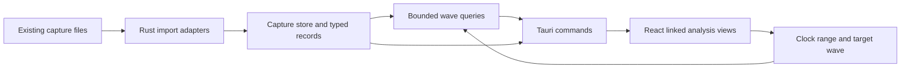

# Architecture: ROCm profiling and kernel experiments

## Product boundary

The immediate milestone is a reliable local analysis desktop that can reconstruct the workflows of ROCprof Compute Viewer. Analysis must remain usable without ROCm installed. This document describes what is built; it deliberately holds no contracts for unbuilt work. The kernel-tuning surface that ships is described in the README, and the external inputs remaining work is waiting on are in [blocked-inputs.md](blocked-inputs.md).

The implementation uses **Tauri 2 + a standalone Rust analysis crate + React/TypeScript**. Rust owns filesystem access, import validation, capture lifetime and wave loading. The webview owns selection, linked views and rendering. This choice gives native parsing and a small desktop host without requiring every graph interaction to cross IPC.

The upstream viewer is a Qt/C++ application, distinct from rocprofiler-compute's high-level metric analysis. Both dispatch/PMC workflows and SQTT instruction/wave workflows matter, but they are different adapters and measurement domains.

## Implemented ownership and interfaces

| Layer | Location | Responsibility |
|---|---|---|
| Profile core | `crates/profile-core` | JSON/CSV imports, scoped sidecar access, timestamp normalization, wave reads, interval union, headless import CLI. Import goes through one cancellable, fingerprinted router (`project::load_input` → `import::load_capture_options`) that the GUI, headless CLI and MCP all share, so they accept the same inputs (including `.rocprof-att`) |
| RADV RGP reader | `crates/profile-core/src/rgp.rs` | Chunked RGP container parsing; derived-SPM and raw user-configured counters on the GPU-timestamp axis; SQTT sanitizing, code-object placement by pipeline hash, and four validity checks before a thread trace is decoded through `decoder.rs`; capture-mode inference; RGP instrumentation markers read from userdata register tokens, which name kernels and give dispatch grids |
| HRX IRPF reader | `crates/profile-core/src/irpf.rs` | Bounds-validated parser for HRX's native IREE HAL `IRPF` v2.0 bundles (`HRX_PROFILE_MODE=queue\|dispatch`): file/record headers, typed chunks, resolved dispatch/function names, code-object identity and clock correlations; elapsed-tick timing via the device frequency with the device-tick-unaligned limitation kept explicit; grid = workgroup count × size. See [`hrx-profiling.md`](hrx-profiling.md) |
| Native host | `src-tauri` | Tauri window, native open dialog, background import tasks, capture handles and lifetime |
| Bridge | `src/bridge.ts` | Typed IPC and explicitly synthetic browser fixture |
| Analysis | `src/analysis.ts` | Visible-range wave statistics, occupancy sweep, safe scalar expression parser |
| Views | `src/components` | Canvas timelines, SVG plots, paged ISA table, source mapping, CU/LDS representation |
| App | `src/App.tsx` | Capture tabs, selected wave/token, history, clock range, navigation and selection export |
| Shader tuning (Vulkan) | `tools/vkcap/`, `src-tauri/src/shader_worker.py`, `src/components/ShaderTuning.tsx` | Capture layer recording one dispatch with its buffers before and after; isolated replay harness; SPIR-V matching and recipe recovery against ggml shader builds; sessions share `tuning.rs` with HIP kernel tuning |
| MCP server | `src-tauri/src/mcp.rs` | Default-on loopback MCP endpoint, bearer token, 31 tools including `profile_run` (combinable rocprofv3 counters/traces/ATT) and the gated `profile_start`/`profile_trigger`/`profile_status`/`profile_stop` live profiling (RADV file triggers or rocprofv3 attach windows); second IPC surface beside the Tauri commands |
| Kernel tuning | `src-tauri/src/tuning.rs`, `tuning_worker.py`, `tuning_calibration.py` | Input capture, Kerncap replay, candidate compilation and source write-back |
| Application data | `src-tauri/src/appdir.rs` | Single owner of the writable data directory: `$ROCPROFGUI_HOME`, else `~/.rocprofgui`. Nothing the app writes goes to the working directory |

A headless launch starts MCP without creating a Tauri runtime. A later GUI launch sends an authenticated local attach request and exits; the original main thread initializes Tauri, retaining the same `Store`, tuning sessions and MCP listener. Closing the attached window hides it, and a later launch shows it again. The attached launcher passes its display session variables to the service so the service can begin without a graphical environment.

Commands and ownership:

The host registers 50 Tauri commands (39 in `main.rs`, 7 in `mcp.rs`, 4 in `tuning.rs`). Only the few below are given in full here; the rest are covered by the same paged-transfer and cancellation conventions.

- `open_capture(path, sampling_method, load_wave_states, instruction_pages, transfer_id)` runs parsing on a blocking worker. Desktop callers supply a known request identity and request a bounded catalog header; legacy callers may still receive a complete capture.
- `read_catalog_page` transfers instructions in order, at most 4,096 records and 4 MiB per page. Only the last page may be retried. `finish_catalog_transfer` commits a complete catalog; `abort_catalog_transfer` disposes staging using its request identity.
- `open_project` stages all referenced inputs and returns a batch header. `read_project_catalog_page` reads individual catalog pages. `finish_project_transfer` replaces the native capture map only when every catalog is complete and retains the previous map until `acknowledge_project_transfer`. Abort or page reload before acknowledgement rolls back. Commit and acknowledgement tolerate retries.
- `read_wave(capture_id, wave_id)` accepts only enumerated wave IDs. Canonicalized paths must remain under the capture directory, including after symlink resolution.
- `read_wave_window(capture_id, se, start, end)` uses a bounded cached interval index to choose overlapping waves, then filters token overlaps before applying the transfer budget. Responses carry original token indexes, occurrence numbers and display slots. Filtered responses omit wait relationships; target selection uses a full wave read for wait analysis. Oversized visible requests fail explicitly.
- `read_wave_overview(capture_id, se, start, end)` returns bounded wave/category/start-time groups with exact event counts and zoom ranges. Primary and independently ranged pinned CU views use it when the exact visible-token budget is exceeded. Each panel owns its pending query and range-matched result. Group spans may contain gaps and are not occupancy or measured-utilization values. Exact statistics do not use these groups.
- `close_capture(capture_id)` releases the stored capture. In-flight reads retain their own immutable `Arc`.
- `live_profile_start/trigger/status/stop` back the desktop "Live profiling" panel. They are thin wrappers that call the same `profile_*_core` functions the MCP `profile_start/trigger/status/stop` tools call (`src-tauri/src/mcp.rs`), so the launch, windowing and collection logic is shared, not forked. Only `live_profile_status` is read-only enough to run while an MCP action holds the lock; the mutating three are refused then, like other local mutations.

Catalog headers still include occupancy, wave indexes, counter arrays and other metadata. Instruction catalogs are assembled in frontend memory from pages; this is bounded IPC, not out-of-core storage. Wave tokens and source text load lazily. Stale asynchronous results are excluded from changed selections. Import cancellation and staged ownership are separate from individual wave-read completion.

Projects are versioned reference files. Schema 2 adds fingerprinted large-source references, schema 3 adds input file-set fingerprints, schema 4 retains each capture's wave-state sidecar import choice, and schema 5 retains explicit PC sampling method selections for raw SDK JSON inputs. Earlier schemas remain readable and default to loading those sidecars. The machine import preference affects future decoded/raw ATT imports; the separate per-capture display preference controls plots without changing expression identifiers. Portable capture archives preserve their packaged normalized data.

Source access uses captured snapshots or explicitly selected replacements. Counter expressions use parsed arithmetic and a bounded worker evaluator, never JavaScript `eval`. Raw ATT decoding runs in an owned subprocess with cancellation, timeout and versioned bundled Python dependencies; the native decoder library and ROCm tools remain external.

## Measurement model

`Capture` owns architecture, format, clock unit/origin, warnings, wave indexes, occupancy intervals, instructions, dispatches, counter series, snapshots and metadata. The clock domain is explicit:

- SQTT time is shader cycles.
- Dispatch CSV and standalone SPM timestamps retain the original integer origin as a string and use relative nanoseconds in JavaScript.
- No cross-domain alignment occurs without calibration.

A detailed wave is identified by its capture and filename, with SE/SIMD/slot/WID coordinates in the index. Global occupancy is paired on SE, CU, SIMD, slot, kernel and dispatcher coordinates. Unmatched boundaries are counted and excluded, not completed using guessed times.

Dispatch deduplication requires matching process, agent, queue, dispatch ID, timestamps and kernel name. Counter-pass rows with distinct timestamps are not assumed to be the same dispatch. If process ID is absent, the imported file is the process boundary.

Register/LDS values are optional metadata. `None` becomes “Not collected,” while an observed numeric zero remains zero. Metadata VGPR counts, register allocation and spills are different concepts. A bank-conflict diagram requires a trustworthy bank-level data source; no synthetic bank heatmap is used for a real capture.

Every view labels its denominator: active waves, accumulated instruction latency, summed recorded kernel durations, or interval-union activity. None implicitly means native application wall time.

## UI interaction model

A capture has a selected shader engine, wave and instruction, plus one shared visible range. Clicking tokens maps to ISA; clicking ISA/source maps to the corresponding source/ISA line. Loop occurrence selects another execution of the instruction in the target wave. Wait links use the selected wave's recorded instruction-token indexes.

The trace workspace provides five related projections: target wave by instruction class, CU waves by SIMD/slot, selected-SE SIMD instruction activity, global occupancy residency, and dispatch queue durations. Occupancy/counter plots use the same range. Lanes and ISA records are paged rather than silently omitted.

CU diagrams show only coordinates actually observed. The cursor selects a time, and active slots come from half-open residency intervals. Static LDS/register metadata is shown for a matching observed kernel; it is not averaged into occupancy or converted into bank-conflict estimates.

## Parity and scaling gates

The detailed gate list is in `upstream-parity.md`. Remaining baseline work precedes claims of feature parity:

1. Complete real-hardware qualification across architecture families, marker ownership, heterogeneous topology, wait reconstruction and matched multi-SE SPM/SQTT timing. Synthetic and archived fixtures qualify specific cases, not all hardware behavior.
2. Extend ROCPD artifact association only when a producer/schema contract establishes identity. Explicit user associations exist; filename matching is not proof of dispatch ownership.
3. Qualify wave-heavy and repeated large-capture workloads. Paged IPC supports the tested six-native-plus-demo project, but catalogs remain resident and WebKit retention/allocator behavior remains unresolved.
4. Complete remaining display, transient-control and export audits, including physical multi-monitor behavior and broader large/hardware export checks.
5. Finish clean-distribution/host desktop integration and cross-distribution packaging qualification. The current release passes isolated dpkg installation, replacement, removal/purge and reinstall with verified payloads, plus installed startup on this host. That private-root check uses copied host dependency records and host runtime libraries, so it does not establish a fresh distribution installation. Packaging now derives versioned ELF dependencies with dpkg-shlibdeps; simulated insufficient libc metadata is rejected during configuration.

Implemented foundations include decoder-worker integration, ROCPD adapters, calibrated SPM mapping, gap-preserving counter plots, tensor expressions, cancellable imports, project persistence and per-tab layout/navigation. Their precise coverage and remaining limits are recorded in `upstream-parity.md`.

The current import caps are guardrails, not a scalability claim. A capture with many files can still consume substantial memory. The bounded wave query loads each selected wave fully before filtering by the viewport; an indexed token store is needed for genuinely huge individual waves.

The record cap, per-file size cap, hidden-latency token cap and ATT-manifest file caps are resolved through `crates/profile-core/src/caps.rs`, which reads a safe default unless a `ROCPROF_MAX_*` environment variable raises or lowers it (README, "Current limits"). They still reject explicitly past the configured bound; they do not sample. The wave-query budgets below are deliberately **not** in that module: their path is not yet paged and their numbers are mirrored in the frontend.

The wave-query budgets are defined once, in `crates/profile-core/src/wave_index.rs`: `MAX_WINDOW_WAVES` (128) bounds an exact viewport selection, `MAX_AGGREGATE_WAVES` (4,096) bounds the statistics and overview queries, and `MAX_VIEWPORT_TOKENS` (500,000) bounds the tokens one viewport query may transfer. Every enforcement site — `lib.rs`, `wave_viewport.rs`, `token_cache.rs`, `token_index.rs` — references those constants rather than repeating the numbers, and each rejection message interpolates the constant value rather than carrying a hard-coded literal, so the bound and the message a user sees cannot drift apart.

The rejection messages are a **cross-language contract**: `src/waveOverview.ts::isWaveDetailBudgetError` matches them by substring to decide when to fall back to the bounded overview, and it must keep distinguishing the 128-wave window message from the 4,096-wave aggregate message. A `#[cfg(test)]` contract test in `wave_index.rs` pins the exact strings so that changing a budget fails a Rust test naming the TypeScript file, instead of silently disabling the fallback.

### Bounded MCP analysis

`capture_query` selects typed rows before converting them to JSON. Without search, only the selected slice is serialized; search scans one admitted row at a time and preserves case-insensitive matching against serialized JSON, including keys and nested values. Encoded admission limits are 4 MiB per row and 16 MiB per selected array (or unpaged response). Complete match counts still require a scan. The source-path registry remains a resident inventory. Paging retains the default 100, clamp 1000, row shapes and `nextOffset`, with additive `effectiveLimit`; zero is count-only.

`src-tauri/src/mcp_analysis.rs` plans borrowed dependency projections and exact-counted job files. Private protocol v2 and its budgets are shared in `src/mcpAnalysisProtocol.json`. Kernel input carries only name/start/end dispatch and residency records. The worker feeds the same incremental TypeScript accumulator as GUI `kernelStats`, in original order, and Rust pages finalized NDJSON rows. Full-capture totals retain the GUI's summed durations, matching lifetime sums, interval union and stable ties; query/limit do not reduce aggregation work, and range/kernel remain inapplicable. State admits at most 65,536 names, 16 MiB of unique name bytes and two million retained pairs. Host interval preflight conservatively counts all residency records, including unmatched names. Offline unions must be computed globally, never summed across independently reduced parts.

Other analyses receive their complete relevant datasets under a 256 MiB encoded input cap. Diagnostics temporarily retains its full borrowed capture inventory. These reducers still materialize their selected input/result; a small page does not bound their reducer state. Activity preserves its historical nullable result. Imported captures remain resident, and encoded/count budgets are not RSS guarantees. Import environment overrides do not change these MCP transport limits. Production Node remains at 1024 MiB with a 120-second deadline.

## References

- Upstream viewer inspected at [`ea1ce2b87562b28e3fb5c8819b5e12573cc14424`](https://github.com/ROCm/rocprof-compute-viewer/tree/ea1ce2b87562b28e3fb5c8819b5e12573cc14424).
- [Tauri architecture](https://v2.tauri.app/concept/architecture/) and [capabilities](https://v2.tauri.app/security/capabilities/).
- `profiling-caveats.md` records the recovered local evidence and its practical implications.
- [`kernel-name-layer.md`](kernel-name-layer.md) maps where `Dispatch.kernel` names are produced, parsed and classified, and the checklist a new backend family (e.g. HRX/loom) must satisfy.
- [`kernel-tuning-parity.md`](kernel-tuning-parity.md) records the HIP (Kerncap) vs Vulkan (vkcap) replay-condition and identity asymmetry.

### Exact visible-wave statistics

`read_wave_stats` uses the cached selected-SE interval index, then decodes and accumulates one wave at a time in Rust. It returns instruction ID, hit count, summed latency and summed stall. Tokens qualify by start time in `[start, end)`, matching the existing statistics convention rather than the timeline overlap convention. Mean mode divides latency by hits while retaining summed stall, as before. The query accepts at most 4,096 waves and 65,536 distinct instruction IDs and rejects invalid ranges and non-finite totals. The 128-wave bound is the separate exact-viewport limit, not this one. It does not transfer token arrays or use CU overview groups. Full per-wave decoding remains a memory and latency constraint.

Frontend result ownership includes capture identity, shader engine and exact range. Stale completions are ignored; pending and failed queries expose a status and no fabricated zero-cost instruction rows. Existing hidden-latency analysis remains authoritative when available. Core archive validation covers 723,297 real gfx11 events across 304 instruction rows; browser tests cover concurrent overview display and sum/mean selection. Native Tauri/WebKit qualification imports that archive through the GTK picker and checks all 3,277 displayed ISA rows across all 22 pages in both sum and mean modes against the verified full-token oracle. All 304 measured instructions and the remaining zero-count rows match in hits, cycles and stall. Browser regressions additionally hold pending queries, resolve an obsolete range after the current range, and reject the next query; loading, stale-response isolation and explicit failure without fabricated rows pass.

### Oversized utilization views

`read_wave_overview` accepts optional `utilization` and `separateLds` flags. In utilization mode Rust infers the same GCN/RDNA clock model as the detailed frontend, projects each token onto its issue interval, routes matrix mnemonics and instruction categories to their issue pipes, and groups projected events by wave, category and start-time bucket. Responses carry pipe and shared-scope fields. Unknown architectures fail explicitly and unknown categories are omitted, matching the detailed view.

Primary and detached utilization panels fall back to this query when exact viewport tokens exceed the 500,000-token transfer budget. They retain other-SIMD overlays separately. Counted groups have zoom ranges but no fabricated instruction/token identity. Labels state that spans may contain gaps and do not represent measured utilization percentages. Selecting a group narrows the range and retries exact events. The 4,096-wave and 65,536-group bounds remain; ingestion still fully decodes each selected wave.

The archived gfx11 trace produces 723,297 projected events in 14,672 groups. Native primary and detached-panel qualification renders the full overview; primary and independent-panel browser tests verify return to exact records and range isolation. Architecture/pipe/issue-quantum tests cover GCN and RDNA semantics, but are not hardware measurements for every supported architecture.

### Streamed exact timeline export

Desktop timeline HTML uses `begin_timeline_export`, `append_timeline_export`, `finish_timeline_export` and `abort_timeline_export`. A caller-owned request ID reserves one writer before the destination picker. The writer stages a same-directory temporary file, enforces sequential chunks of at most 1 MiB and a 512 MiB total, verifies the HTML header/footer and final chunk count, and atomically replaces the destination only on completion. Open capture inputs are protected at selection and commit. Aborting or dropping the session removes staging; page-load start also clears an abandoned session. A bounded in-memory cache retains the last 32 completion receipts, keyed by request ID and chunk count. Retrying a completed commit returns its byte count without writing again or touching another active export; a mismatched chunk count and reuse of a retained request ID are rejected. Receipts survive webview reload but not process restart. The frontend retries one failed commit response and preserves confirmed publication status even if cancellation arrives during commit. If both confirmations are unavailable, the UI explicitly reports that the completed file may already exist; cleanup failure cannot mask this uncertainty. Receipts attest the original publication, not the file contents after external edits.

The renderer flushes bounded text buffers to the writer, permits up to two million exact glyphs and 512 output pages, and bisects dense token-budget failures up to 256 time segments. It never exports overview groups as exact geometry. Events crossing boundaries may appear on both pages. Per-query wave/token constraints and full per-wave decoding still apply. Browser downloads retain the existing 16 MiB / 100,000-glyph bounds.

MCP uses this renderer through a file sink, retaining at most 100,000 exact marks / 16 MiB of encoded marks per window and chunks of at most 1 MiB. Rust projects only the requested overall range and preserves original array ordinals; Node rescans the bounded NDJSON transport for each window. Typed window-budget errors trigger subdivision; malformed records, oversized individual strings, cancellation, I/O and total glyph/output exhaustion do not. Both glyph builders admit each insertion before overlay expansion. Positive intervals keep strict overlap and may duplicate across segments; points use `[start,end)` ownership, including the lower boundary and assigning split-midpoint points once to the right segment.

Inline MCP HTML retains its 16 MiB / 100,000-glyph ceiling. A new output path allows 512 MiB / two million glyphs, with `maxOutputBytes` optionally lowering the applicable byte ceiling. The worker closes a staged file and returns only a validated receipt. Rust copies UTF-8 chunks through `TimelineFile::finish_new`, checks header/footer/byte counts and commits without replacing an existing path or symlink. Cancellation before commit removes staging; completed publication preserves its successful RPC response even if cancellation arrives immediately afterwards. Desktop `finish` retains its existing atomic replacement semantics. Additive MCP export metadata records range, clock, coverage, warnings, actual counts and effective budgets; cross-page glyphs do not imply distinct dispatches.

The native archived gfx11 full-range CU export produces 161,914,638 bytes in two pages, preserving all 723,297 token identities and contiguous per-wave indexes. Its 723,298 token rectangles include one boundary duplicate, plus 24 decoder-event rectangles. The standalone document renders in Chromium. Native WebKit qualification now covers owner-scoped abort, preservation of existing destinations, incomplete-finish rejection, page-reload cleanup and stale-chunk rejection, abort during the save picker, and successful export afterward. The frontend abort signal releases staging immediately while an exact query or chunk call remains pending; final cleanup repeats the owner-scoped abort after that call settles. A browser test exercises the actual Cancel button during a held chunk and confirms no publication and restored controls. The large utilization export is also qualified on the same archived gfx11 capture: 183,187,461 bytes across two pages preserve 723,297 unique tokens and 65,640 distinct other-SIMD activity records. Every exported token is checked against independently executed Rust projection for exact issue interval, pipe lane and clipped SVG geometry. The standalone document renders in Chromium and its screenshot is inspected. This fixture covers LDS, SCAL, VALU, VMEM and shared IMMED/JUMP/MSG lanes; other architectures and pipe categories remain separate qualification gates.

Native completion-receipt qualification verifies retry results, chunk-count and reused-ID rejection, isolation from a newer active writer, survival across webview reload, and unchanged committed files after late aborts. Browser regressions cover a lost first reply, late cancellation after publication, and ordinary cancellation while a chunk is pending. Focused Rust tests enforce the 32-receipt retention bound.
